# TokenGo — Multi-Vertical Service Marketplace: Architecture Proposal (Phase 0)

| | |
|---|---|
| **Status** | **Implementation started 2026-10-06** after the requester said to begin coding once the draft existed. I read that as approval to proceed with the recommended defaults (§X D1–D14); it is **not** an answer to the blocking questions Q1–Q7 (country/entity, payment model, PSP, team/budget, whiteboard, map provider, account ownership), which remain open. Progress: [`STATUS.md`](STATUS.md). Deviation recorded in [ADR-0002](adr/0002-nestjs-11-commonjs-toolchain.md) (NestJS 11, not 12). |
| **Date** | 2026-10-06 |
| **Source** | `requiremnts.md` (sections referenced as §n) |
| **Scope of this document** | Sections A–V as required by §38, plus a proposed repository structure (§W) and an approval checklist (§X) |

**Legend used throughout** (as §38 asks me to distinguish them):

| Tag | Meaning |
|---|---|
| **[R]** | Confirmed requirement — stated in `requiremnts.md` |
| **[REC]** | My recommendation — you may override |
| **[ASM]** | Assumption I made to proceed — please correct if wrong |
| **[DEC]** | Decision that needs your explicit approval before it is locked in |

> **Important honesty note.** Regulatory, tax and payment-provider statements below are my *understanding* and have **not** been verified against current primary sources, the provider's contract, or by counsel. They are flagged so they can be verified — they are not legal advice. Cost and effort figures are planning estimates, not quotes.

---

## 0. Executive summary

**What:** A multi-vertical booking marketplace (Salon first) with a Customer app, a Provider app (both Flutter), an Admin portal (Next.js), and one backend, built so that doctors, labs, spas, restaurants, etc. can be added by configuration plus well-defined extension points.

**The ten decisions that shape everything** (details in the sections that follow):

1. **Modular monolith** (NestJS/TypeScript) with two process types from one image: `api` and `worker`. No microservices, Kafka, or Kubernetes. [R][REC]
2. **PostgreSQL 16+ with PostGIS** is the single source of truth; double-booking is prevented by a **database exclusion constraint**, not just application checks. [REC]
3. **Double-entry, append-only ledger** with explicit accounts for *customer available*, *customer held*, *provider payable*, *platform commission*, and *in-transit payout* — plus a separate `wallet_holds` state machine. [R]
4. **The wallet model is legally unresolved** (§13 of your requirements). I propose the ledger and hold model be **funding-source agnostic** (wallet-backed *or* payment-authorization-backed) so the code survives whichever model counsel/PSP approve. **Real-money movement stays disabled until that is resolved.** [R][REC]
5. **Booking creation is one database transaction** (idempotency record → wallet lock → availability check → appointment insert → hold + ledger entries → events). Nothing partial can persist. [R]
6. **Provider payouts are never "send and hope":** every payout carries our own idempotent reference; a timeout means *unknown*, resolved by querying the provider before any retry. [REC]
7. **Transactional outbox** + Postgres-backed jobs for notifications, expiry, settlement and payouts; no Redis in v1 unless load tests justify it. [R][REC]
8. **Authorization is server-side RBAC with scoped role assignments** (platform / provider / location) plus object-level ownership checks; MFA required for privileged roles. [R]
9. **AWS `ap-south-1` (Mumbai), ECS Fargate, RDS Multi-AZ**, one AWS account per environment, Terraform. [REC][ASM]
10. **Delivery is vertical slices** (backend + app screens + tests per phase). Planned critical path ≈ 34 weeks for a ~9-person team, ≈ 9–10 months with contingency — *sandbox money only*; production money movement is gated by compliance, not engineering. [REC][ASM]

**What I need from you:** answers to the blocking questions in §A.5 and the approvals in §X. The single biggest risk to the whole project is **§K.4 / §U-R1 (can we lawfully hold customer funds?)**.

---

## A. Requirements, assumptions, and open questions

### A.1 Repository inspection (§1, §37 rule 1)

- `E:\mobile-app\TokenGo` contains **only** `requiremnts.md`. Not a git repository. No code, infra, or CI exists. → Treated as **greenfield**; nothing can be overwritten.
- **The "attached whiteboard image" (§ intro) was not found.** I have designed from the text only. If the image contains something not in the text (extra screens, flows, terms such as "token"), please add it to the folder; I'll reconcile before approval.
- The folder name `TokenGo` is assumed to be the product/working name. [ASM]

### A.2 Confirmed requirements digest [R]

| Area | Key confirmed requirements | § |
|---|---|---|
| Product | Customer app, Provider app (Android+iOS), responsive Admin portal, backend, DB, payments, notifications, monitoring, cloud | intro |
| Architecture | Modular monolith; API-first; relational source of truth; explicit state machines; idempotency; transactional outbox; no Kafka/K8s/microservices without documented need | 2 |
| Stack direction | Flutter; Next.js+TS; NestJS **or** FastAPI (one only); PostgreSQL+PostGIS; Redis only if justified; S3 private; AWS+Docker+IaC; 3 environments | 3 |
| Users/RBAC | 7 user types; granular RBAC; server-side enforcement; MFA for privileged; owner data isolation | 4 |
| Customer app | OTP login, profile, location (manual fallback, no startup permission wall), categories (admin-configured), map+list search, booking, wallet, cancellation, refunds, notifications, reviews, support/disputes, account deactivation/deletion | 5 |
| Provider app | Business registration/verification, locations, services/prices, staff & skills, schedules/leave, requests approve/reject, arrival/start/complete, earnings, payable, payouts, reviews, notifications, disputes | 6 |
| Multi-vertical | Generic entities; Salon fully implemented; other verticals via metadata + extension points, not pretending identical flows | 7 |
| Search | Radius, category, service, price, rating, availability, open/closed, distance, staff availability; map/list/detail/directions; PostGIS; no background tracking; minimal location retention | 8 |
| Pricing | Server computes all amounts; immutable pricing snapshot per booking; extra charges need explicit customer approval | 9 |
| Availability | Hours, staff schedules, skills, breaks, leave, holidays, existing bookings, duration, buffer, lead time, max advance, expiry, cancellation, timezones; UTC storage; DB-level overlap prevention; transactional revalidation | 10 |
| Ledger | Immutable double-entry-style ledger; holds; no `balance = balance - x`; integer minor units; compensating entries; reconcilable | 11, 12 |
| Payments | Provider abstraction; sandbox first; verified webhooks; server-side verification; reconciliation; duplicate-callback protection; no client-trusted success | 13, 14 |
| Booking | Explicit state machine; separate payment/settlement status; append-only events; no generic status CRUD | 15, 16 |
| Approval | Configurable provider response deadline; expiry releases hold exactly once; DB-backed jobs | 17 |
| Arrival | QR / PIN / authorized confirmation; no sensitive data in QR; no auto-complete on end time | 16, 18 |
| Commission | Percentage/fixed; category/provider/service-specific; effective-dated; captured in booking snapshot; payable ≠ paid | 19 |
| Cancel/refund/dispute | Configurable policy; disputes with evidence and admin decision; never refund more than permitted | 20 |
| Admin | Full management scope; maker-checker; no payment secrets in UI; audited | 21 |
| Notifications | Push/in-app/email/SMS via outbox; retries; delivery status; dedupe | 26 |
| Quality | Listed test areas + 10 critical financial tests; CI/CD pipeline; docs set; seed data (dev only) | 29, 32, 34, 35 |
| Process | Phased delivery, acceptance criteria per phase, honest reporting, root-cause documentation for defects | 36, 37 |

### A.3 Gaps and tensions I found in the requirements

These are not errors on your part; they are places where a literal implementation would hit a wall. Each has a proposed resolution.

| # | Observation | Proposed resolution |
|---|---|---|
| G1 | §15 lists states but **no NO_SHOW state**, though §20 requires customer/provider no-show handling. | Add `NO_SHOW` (customer). Provider no-show = `PROVIDER_CANCELLED` with `reason_code=PROVIDER_NO_SHOW` (set via customer report/support). **[DEC]** |
| G2 | `PROVIDER_APPROVED` and `CONFIRMED` are adjacent and indistinguishable in behavior. | Collapse: approval moves directly to `CONFIRMED`; the approval is recorded as an event. Keep `PROVIDER_APPROVED` only if you need a distinct step (e.g., a customer re-confirmation). **[DEC]** |
| G3 | `DRAFT`, `PAYMENT_PENDING`, `PAYMENT_HELD` imply a persisted multi-step flow, but §16 step 12 demands **atomic** hold + request. | In the wallet model these three are *transient inside one transaction* (recorded as events, never visible as resting states). They become real resting states **only** for a per-booking-payment model (§13 option B) where the PSP is asynchronous. The enum includes them so we don't need a redesign later. **[DEC]** |
| G4 | §16 forbids auto-completing on end time, but §12 requires holds be released/settled. A booking nobody completes would **hold funds forever**. | Add a configurable **stale-booking workflow**: past end time + grace → flag to support queue, notify both parties, escalate to `DISPUTED` after N hours. Never auto-settle to the provider silently. Holds get a configurable review deadline. **[DEC]** |
| G5 | §16 step 23 says settlement requires "applicable conditions" but doesn't define them. | Proposed default: settle when (a) no unaccepted additional charge, (b) no open dispute, and (c) **customer confirms OR a configurable dispute window (default proposed: 24 h) elapses**. Window length is config. **[DEC]** |
| G6 | §9 requires customer approval of **additional charges**, but the original hold only covers the base price. | An accepted additional charge creates a **second hold** (same booking, `purpose=ADDITIONAL_CHARGE`). If funds are insufficient the customer tops up or the charge cannot be settled. **[DEC]** whether pay-at-counter for the difference is allowed. |
| G7 | §22 lists `reservations` and `service_requests` separately from `appointments`. | v1 implements `bookings` + `booking_items` + `appointments` (time blocks). `service_requests` (home services) is a *future* sibling aggregate; not built now. |
| G8 | §13 conflicts with §11/§12 if the wallet is not legally permitted. | See §K.4. The ledger/hold design is deliberately funding-source-agnostic. |
| G9 | Post-settlement complaints: §20 dispute flow doesn't say what happens **after** the provider payable was accrued/paid out. | Disputes are only raised before settlement. After settlement: admin **adjustment** (compensating ledger transaction) recoverable against future payables; requires maker-checker. **[DEC]** |
| G10 | §5 "Account deletion" vs. §11 "financial records must not be deleted". | Deletion = **anonymization** of PII; ledger/audit rows retained with the pseudonymous user ID for the legally required period (period to be set by counsel/CA). Documented in PII-DATA-FLOW.md. |
| G11 | §10 "simultaneous booking attempts" + "any available stylist" requires a choice rule. | Deterministic auto-assignment (least-loaded then lowest id), retried across candidates on exclusion-constraint violation. |
| G12 | §6/§10 do not mention **walk-in / provider-created bookings**. A salon will have walk-ins that consume stylist time. | Provider app needs "block time / add walk-in" that writes to the same `appointments` table (no financial leg). **[DEC]** include in v1? Recommended **yes** — otherwise availability is wrong in real use. |
| G13 | iOS/Android store rules. Apple and Google both require **in-app account deletion** (supports §5). Apple review may scrutinize wallet top-ups. | Account deletion built in v1; wallet top-up for real-world services sold outside the app is generally permitted to use external payment — to be verified against current guidelines during Phase 10. |
| G14 | SMS OTP in India requires **TRAI DLT registration** (entity, headers, templates). | Start DLT registration in Phase 0 — it is a long-lead item that can block OTP login. |
| G15 | Minors: customers may be under 18. DPDP Act treats children's data specially (verifiable parental consent). | Require 18+ declaration at registration in v1. **[DEC]** |

### A.4 Assumptions [ASM]

| # | Assumption | Impact if wrong |
|---|---|---|
| S1 | Launch market is **India**, currency **INR** (₹ used in §9/§12), single currency in v1 but schema is currency-aware. | Payment provider, tax, regulatory sections change. |
| S2 | Initial scale: ≤ 10,000 customers, ≤ 300 providers, ≤ 2,000 bookings/day; design headroom 10×. A single Postgres primary is sufficient. | Sizing, caching, and read-replica decisions change. |
| S3 | Team ≈ 9 FTE: 1 architect/tech lead, 3 backend, 2 Flutter, 1 web, 1 QA, 0.5 DevOps, 0.5 UX. | Elapsed time scales roughly inversely (a 5-person team ≈ 1.7–1.9× longer). |
| S4 | Source control on **GitHub** (CI = GitHub Actions). | CI/CD specifics change; concepts do not. |
| S5 | One booking = up to *N* services (config, default **1**) performed contiguously by one staff member. Schema supports N items; v1 UI exposes 1. | Multi-service UX is additional scope. |
| S6 | A pending (`REQUESTED`) booking **blocks** its slot until approved/rejected/expired, so two customers can't both hold the same slot. | If you prefer "soft-hold", conflicts surface at approval time. |
| S7 | Customers pay **only** through the platform (no cash-at-venue) in v1. | Cash flows bypass the ledger; commission collection becomes a different problem. |
| S8 | English + one regional language framework (i18n-ready), English strings shipped first. | Localization effort. |
| S9 | GST handling: prices displayed tax-inclusive; GST on platform commission, TCS/TDS treatment **to be determined by a CA**; the schema reserves tax fields. | Financial snapshot and reports need rework if tax is mandated at launch. |
| S10 | Provider payouts to **bank accounts** (UPI/IMPS/NEFT via PSP payout product), not wallets. | Payout provider choice. |

### A.5 Open questions

**Blocking** (needed before Phase 1 starts or before the relevant phase can be designed):

| # | Question | Needed by |
|---|---|---|
| Q1 | **Launch country/city and legal entity.** Is India correct? Is there a registered company, and does it hold or plan to obtain any RBI authorization? | Phase 0 exit |
| Q2 | **Payment model (§13 A/B/C).** Has counsel/CA been engaged? Which model do you *want* to pursue first (wallet vs per-booking payment)? | Phase 0 exit |
| Q3 | **Preferred PSP(s)** for sandbox (Razorpay / Cashfree / Stripe-IN / other) and whether you already have sandbox accounts. | Phase 0 exit |
| Q4 | **Team size, budget, and target dates**, so I can re-plan phases realistically. | Phase 0 exit |
| Q5 | **Whiteboard image** — please add to the folder. | Before approval |
| Q6 | **Map provider**: Google Maps vs Mapbox (cost/licensing). | Phase 2 start |
| Q7 | Ownership of **Apple Developer / Google Play / AWS / domain** accounts and brand names. | Phase 1 start (AWS), Phase 10 (stores) |

**Non-blocking** (I will use the stated default unless you say otherwise):

| # | Question | Default |
|---|---|---|
| Q8 | Walk-in / provider-created bookings in v1 (G12)? | Yes |
| Q9 | Does `REQUESTED` block the slot (S6)? | Yes |
| Q10 | Settlement rule (G5): confirm-or-24h dispute window? | Yes, window configurable |
| Q11 | Provider response deadline default? | 30 min, configurable per category/provider |
| Q12 | Customer wallet withdrawal back to bank — allowed? (regulatory) | **No** in v1; refunds to wallet or to source only as approved |
| Q13 | Discounts, promos, coupons, referral credits in v1? | **Out of scope** v1; snapshot schema has fields |
| Q14 | Multi-service bookings in v1 UI (S5)? | Single service |
| Q15 | Multiple locations per provider in v1? | Yes (schema + provider app), since §6 "Location management" |
| Q16 | Provider KYC documents required (PAN, GST, shop license, bank proof, ID photo)? Aadhaar must **not** be stored unless legally required. | PAN + business proof + bank account verification (penny-drop via PSP) |
| Q17 | Review rules: verified-completed bookings only, moderation queue. | Yes |
| Q18 | Data-retention periods for financial/audit/PII. | Placeholders in PII doc, to be set by counsel/CA |
| Q19 | Support tooling: build lightweight in-app tickets/disputes vs integrate a helpdesk. | Build minimal in-app (as §5/§20 describe) |
| Q20 | Languages beyond English at launch? | English only; i18n-ready |

---

## B. Recommended technology stack and trade-offs

### B.1 Stack table [REC] — final selection needs your approval **[DEC]**

| Layer | Choice | Why | Main alternatives | Trade-off accepted |
|---|---|---|---|---|
| **Backend** | **NestJS (TypeScript), Node.js current LTS** | One language across API and admin portal; first-class module system maps directly to modular-monolith boundaries; strong OpenAPI generation; large ecosystem for auth, queues, validation; easy hiring. | FastAPI (Python) | Node's single-threaded CPU model (not an issue for an I/O-bound booking API; CPU-heavy work stays out of the request path). Money must use integer/bigint discipline (JS floats are banned in domain code). |
| **DB access** | **SQL-first migrations + Kysely (typed query builder)** for booking/ledger paths; plain `pg` for hot paths | Financial and scheduling code needs `SELECT … FOR UPDATE`, `SKIP LOCKED`, exclusion constraints, `tstzrange`, PostGIS and explicit transaction control. Heavy ORMs hide or fight these. | Prisma, TypeORM, MikroORM | More hand-written SQL; mitigated with type generation from the live schema and repository-level tests against a real Postgres. |
| **Migrations** | Forward-only SQL migrations (e.g. `node-pg-migrate`; choice recorded in ADR) with expand/contract policy | Reviewable SQL, deterministic, works in CI and ECS release tasks. | Flyway, Atlas, ORM-generated | None significant. |
| **Database** | **PostgreSQL 16+ (RDS) with PostGIS and `btree_gist`** | Transactions + constraints are the backbone of §10–§12; PostGIS covers §8. | Aurora PostgreSQL | RDS is simpler/cheaper at this scale; Aurora can come later without app change. |
| **Jobs / scheduling** | **`pg-boss`** (Postgres-backed queue, `SKIP LOCKED`) + custom **outbox dispatcher** | Reuses the existing DB, transactional enqueue, no extra infra. Delayed jobs for expiry/reminders. | BullMQ+Redis, SQS | Throughput ceiling is well above S2's needs; revisit if load tests say otherwise. |
| **Cache / rate-limit** | **No Redis in v1.** OTP/login throttling in Postgres (correctness-critical, low volume); coarse IP rate limiting at AWS WAF. | §3 says "Redis where justified" — not yet justified. Fewer moving parts to secure and operate. | ElastiCache | Per-user API rate limiting is coarser until Redis is added; **trigger to add Redis**: p95 latency or lock contention evidence from Phase 9 load tests, or need for distributed fine-grained limits. |
| **Mobile** | **Flutter** (Dart), Melos monorepo; **two apps** (`customer_app`, `provider_app`) + shared packages | §3 direction; one codebase for iOS+Android; separate apps per §3/§6. | React Native | Dart skills required; strong map/animation support. |
| **Mobile state/nav** | Riverpod, go_router, Dio + generated API client, freezed, flutter_secure_storage | Testable, explicit, widely used. | Bloc | Preference; either is fine — recorded in ADR. |
| **Admin portal** | **Next.js (App Router) + TypeScript**, Tailwind + shadcn/ui, TanStack Query/Table | §3; BFF pattern for cookie sessions (§M). | Plain React SPA | Needs a Node runtime (runs on ECS, not static hosting). |
| **API contract** | **OpenAPI 3.1 generated from NestJS**, typed clients generated for Dart and TypeScript | Single source of truth for contracts (§23). | Hand-written clients | Codegen toolchain to maintain. |
| **Object storage** | S3 private buckets, SSE-KMS, presigned URLs, malware scan | §3, §25 | — | — |
| **Compute** | **ECS on Fargate** (api, worker, admin-web) | Docker-based, no Kubernetes (§2). | EKS, EC2, App Runner | Fargate costs slightly more per vCPU than EC2 but removes host ops. |
| **IaC** | **Terraform** (modules per environment) | Plan/diff review in PRs, widely known. | AWS CDK (TS) | CDK would share language with the team; Terraform chosen for review ergonomics. ADR. |
| **Push** | **FCM** (Android + iOS via APNs) | One integration for both platforms. | OneSignal, SNS | Google dependency; acceptable. |
| **Email** | **Amazon SES** | Cheap, in-region. | SendGrid | Needs domain verification/warm-up. |
| **SMS/OTP** | Provider abstraction; initial adapter to an India SMS aggregator (DLT-compliant) | §3 | Twilio | DLT registration lead time (G14). |
| **Maps** | `MapProvider` abstraction in Flutter + `GeocodingProvider` in backend; **Google Maps** or **Mapbox** (Q6). **Directions via native deep links** (Google/Apple Maps) rather than the paid Directions API. | Avoids per-call directions cost; satisfies §8 "directions". | In-app routing | No turn-by-turn inside our app. |
| **Observability** | Structured JSON logs (pino) → CloudWatch; OpenTelemetry traces; Sentry (backend/admin) + Firebase Crashlytics (mobile) | §31 | Datadog | Cost vs. depth; start light. |

### B.2 Why NestJS over FastAPI (§3 asks for explicit reasoning)

| Criterion | NestJS | FastAPI | Verdict |
|---|---|---|---|
| Team productivity | Same language as the Next.js admin; shared validation/types utilities | Python; separate ecosystem from admin | NestJS |
| Transaction handling | Fine with explicit `pg` transactions; no framework magic | Equally fine with SQLAlchemy/asyncpg | Tie |
| Modularity | Built-in modules/DI map to §27 boundaries; boundaries lintable | Requires convention | NestJS |
| Ecosystem | Mature auth/queue/OpenAPI libs | Excellent; strongest for data/ML (not needed) | Tie |
| Maintainability / LTS | Opinionated structure; large community | Smaller convention surface; flexible | Slight NestJS |
| Hiring (India) | Large TS/Node pool | Large Python pool | Tie |

**Risk acknowledged:** NestJS's DI can encourage cross-module reach-through; §D adds lint-enforced boundaries to prevent that.

### B.3 Money representation [REC]

- DB: `bigint` minor units + `char(3)` currency. No `numeric`/`float` for money. Rates (commission %) stored as integer **basis points** (`1000` = 10.00%) to avoid decimals.
- Domain: a `Money` value object wrapping `bigint`; arithmetic only through it; rounding rule explicit and tested (round half-up on commission; any residual paise goes to the **provider payable** side so `payable + commission = amount` exactly).
- API: `{ "amount_minor": 20000, "currency": "INR" }`. Clients format; servers never accept totals (§9).

---

## C. High-level system architecture

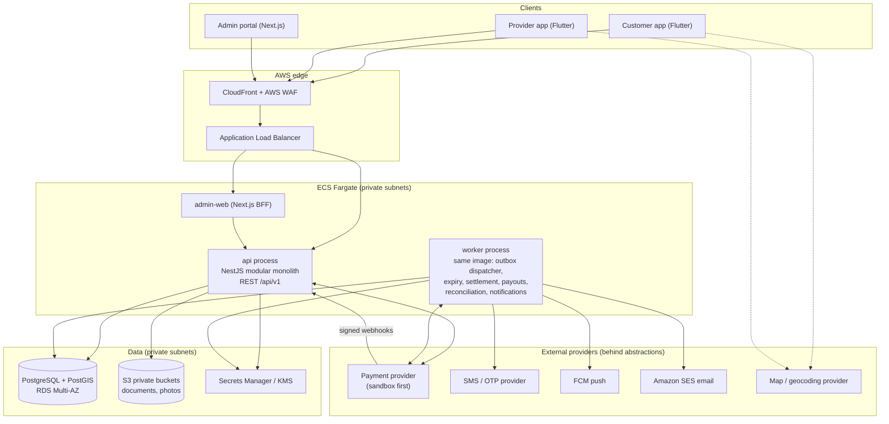

**Runtime shape.** One codebase, one container image, two entry points:

- `api` — stateless HTTP; horizontally scalable (≥ 2 tasks in prod).
- `worker` — no HTTP surface except health checks; claims work with `FOR UPDATE SKIP LOCKED`, so it can scale to N replicas safely.
- Everything meaningful happens in Postgres transactions; asynchronous side effects (notifications, PSP calls) are triggered via the **outbox** and **jobs**, never inside the money-critical transaction (no distributed transactions, §28).

**Cross-cutting infrastructure** (shared kernel, not a "module"): config, logging w/ correlation IDs, clock abstraction, Unit-of-Work (transaction context), idempotency middleware, outbox writer, authorization guard, error model, `Money`.

---

## D. Modular monolith boundaries and dependency rules

### D.1 Modules (§27)

Each module is a folder with `domain/ application/ infrastructure/ presentation/` layers, **owns its own Postgres schema**, and exposes a **public facade** (an interface + DTOs + domain events). Nothing else is importable from outside the module.

| Module (PG schema) | Owns | Public interface (examples) | May depend on |
|---|---|---|---|
| **identity-access** (`identity`) | users, OTP, sessions, MFA, roles, permissions, assignments | `AuthFacade`, `AuthorizationFacade.can(actor, perm, resource)` | shared-kernel |
| **customer** (`customer`) | customer profiles, saved addresses, consent records, deletion requests | `CustomerFacade` | identity-access |
| **provider-management** (`provider`) | providers, locations, staff, documents/verification, resources | `ProviderFacade` (read models + commands) | identity-access, audit |
| **catalog** (`catalog`) | categories, service types, provider services/prices, policies config (booking, cancellation, commission rule *definitions*) | `CatalogFacade.getPricedService(...)` | provider-management (read) |
| **geo-search** (`search`) | PostGIS queries, search read-model | `SearchFacade` | catalog, provider-management, availability (read), review (read aggregates) |
| **availability** (`scheduling`) | working hours, breaks, leave, holidays, slot engine | `AvailabilityFacade.findSlots / assertSlotFree` | catalog, provider-management |
| **booking** (`booking`) | bookings, items, appointments, events, verification tokens, additional charges, booking state machine | `BookingFacade` commands & queries | availability, catalog, wallet-ledger, provider-management, audit |
| **wallet-ledger** (`ledger`) | ledger accounts/transactions/entries, wallet accounts, holds | `LedgerFacade.hold/release/settle/…` | shared-kernel only |
| **payments** (`payments`) | payment intents/transactions, webhook events, PSP adapters, refunds | `PaymentsFacade` | wallet-ledger |
| **settlement-payouts** (`settlement`) | commissions, provider payables, payouts, reconciliation | `SettlementFacade` | wallet-ledger, payments, booking (events/read) |
| **notifications** (`notify`) | templates, notification records, delivery attempts, device tokens | consumes events only | outbox events (no direct module calls in) |
| **reviews** (`review`) | reviews, ratings aggregates | `ReviewFacade` | booking (read) |
| **disputes** (`dispute`) | disputes, messages, evidence, decisions | `DisputeFacade` | booking, wallet-ledger (via settlement), audit |
| **administration** (`admin`) | admin-specific commands, maker-checker approvals, platform settings | orchestrates other modules' **facades** only | all facades (read/commands) |
| **reporting** (`reporting`) | read-only SQL views / report definitions | `ReportFacade` | read-only access to designated reporting views |
| **audit** (`audit`) | immutable audit log | `AuditFacade.record(...)` | shared-kernel |
| *platform* (`platform`) | outbox, idempotency records, job tables, feature flags | internal | — |

### D.2 Dependency rules [R §27]

1. A module may call **another module's facade only**; importing another module's repositories, entities, or tables is a build failure.
2. **No cross-schema writes.** Only the owning module's repository writes its tables. The DB roles reinforce this (§G.6).
3. Cross-module **reads** go through facades or **explicitly named read views** (reporting is the only broad exception, read-only).
4. `wallet-ledger` and `audit` are **leaf modules** — they depend on nothing but shared-kernel. Nobody can alter ledger tables except through `LedgerFacade`.
5. `notifications` never calls domain modules; it reacts to outbox events and reads only what the event carries (plus its own tables).
6. Cycles are forbidden (checked by `dependency-cruiser`/`eslint-plugin-boundaries` in CI plus an architecture test).
7. Cross-module foreign keys: allowed **only** for identity references (`user_id`, `provider_id`, `booking_id`) and each one is listed in `DATABASE.md`; no cascading deletes across modules.

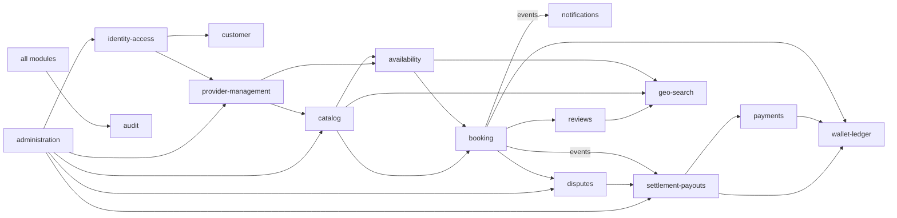

### D.3 The transaction-sharing caveat (stated honestly)

Booking creation must create the booking and the hold **atomically** (§16 step 12), so `booking` calls `wallet-ledger` **synchronously inside the same DB transaction** via a shared Unit-of-Work. This is the correct choice for a monolith, but it is also the **one place** that would turn into a saga if the ledger were ever extracted into its own service. Extraction readiness is therefore: (a) every cross-module call already goes through a facade, (b) every cross-module interaction is idempotent and keyed, and (c) the outbox already carries events. I will document that extraction would require replacing the synchronous hold with a *reserve → confirm* saga (ADR-001).

### D.4 Extension points for future verticals (§7) [REC] **[DEC]**

| Concern | Mechanism |
|---|---|
| Category-specific flow | `categories.booking_flow_type` (`APPOINTMENT_SLOT` implemented; `TABLE_RESERVATION`, `SERVICE_REQUEST_WINDOW`, `TEST_ORDER_WITH_COLLECTION` reserved) → resolved to a `BookingFlowStrategy` interface (`validateRequest`, `computeAvailability`, `requiredFields`). Only the slot strategy exists in v1. |
| Category/service attributes | `service_types.attribute_schema` (JSON Schema) validates `provider_services.attributes` (jsonb), e.g., doctor specialty, lab sample type. |
| Schedulable thing | `bookable_resources` (kind: `STAFF` in v1; later `TABLE`, `ROOM`, `VEHICLE_BAY`). A `provider_staff` row links to its resource. The exclusion constraint is on `resource_id`. **Capacity-based** resources (restaurant tables, party size) will use a different strategy rather than this exclusive-time constraint — I am not pretending they behave the same. |
| Config scoping | `booking_policies`, `cancellation_policies`, `commission_rules` are resolved **most-specific-wins** (service → provider → category → platform), each effective-dated and versioned. |

---

## E. Customer and provider application architecture

### E.1 Monorepo (Melos)

```
mobile/
  apps/customer_app/      provider_app/
  packages/
    core/                 # Money, Result, errors, clock, logging, feature flags
    design_system/        # tokens, themed widgets, accessibility helpers
    api_client/           # generated from OpenAPI (Dio); no hand edits
    auth/                 # OTP login, token storage, refresh/rotation, session
    maps/                 # MapProvider abstraction + adapters, location service
    notifications/        # FCM registration, in-app inbox
    booking_ui/ (shared widgets: slot picker, status chips, price breakdown)
```

Layering inside each feature: `presentation (widgets) → application (Riverpod notifiers/use-cases) → domain (pure models) → data (repositories over api_client)`. Presentation never talks to HTTP directly.

### E.2 Key behaviors

| Concern | Design |
|---|---|
| **Flavors** | `dev`, `qa`, `prod` with separate API base URLs, FCM projects, and map keys. |
| **Token storage** | Access token in memory; refresh token in `flutter_secure_storage` (Keychain / Keystore). Rotation with reuse detection handled server-side (§M). |
| **Location** | No permission request at start (§5). Home screen works with a **manually selected area**; permission requested only when the user taps "Use my location"; foreground-only; coordinates sent per search request, never persisted client- or server-side beyond what the user saves as an address. |
| **Idempotency / app closure (§28)** | The app generates the `Idempotency-Key` **once per booking attempt and persists it locally** before sending. On relaunch it can safely retry the same key or call `GET /appointments?idempotency_key=…`/pending-attempt endpoint to learn the true outcome. The server remains authoritative. |
| **Prices/availability** | Displayed from server; confirm screen re-fetches a **server quote** (price, duration, policy summary, hold amount) immediately before submit. The client never sends totals. |
| **Wallet UX** | Always shows **Available** and **Held** separately with a transaction list (hold/release/settle/refund/top-up) — transparency per §33. |
| **Push** | FCM token registered per device/session; notification tap deep-links to the booking. Push is a *hint*; screens refetch state from the API. |
| **Offline/resilience** | Read screens cache last-good data; commands require connectivity; clear "pending/unknown" states, never optimistic UI for money. |
| **QR/PIN** | Customer app displays a short-lived signed QR + a PIN for the booking (shown only on the booking detail within the arrival window). |
| **Accessibility** | Semantics labels, dynamic type, contrast tokens, 48dp targets; accessibility checks in Phase 9. |
| **Account deletion** | In-app request → server workflow (§G.8, §N). |
| **Security** | No secrets in the app; map keys restricted by package/bundle ID; screenshots blocked on wallet/QR screens (configurable); minimal logging. |

### E.3 Customer app — screen map

Onboarding/OTP → Home (categories configured by admin, location chip) → Search results (map ⇄ list, filters/sort) → Provider detail (photos, rating, hours/open-now, services & prices, staff, next slots, cancellation policy summary, directions) → Service/stylist/date/slot selection → Booking review (server quote, hold amount, policy) → [Add funds if insufficient] → Booking status/tracking → Booking detail (QR/PIN, cancel, refund status, chat-lite/support, review) → Wallet (available/held/history/add funds) → Notifications → Profile/privacy (export, deactivate, delete) → Support & disputes.

### E.4 Provider app — screen map

Business registration → Verification status/doc upload → Dashboard (today, pending requests, upcoming, completed, earnings, payable, pending payouts, ratings) → Requests (approve/reject with reason) → Schedule (per staff; block time; walk-in) → Appointment detail (verify QR/PIN, arrived, start, complete, propose additional charge) → Catalog (services, prices, durations, buffers, staff eligibility) → Staff (invite, skills, hours, breaks, leave) → Locations & hours → Earnings (commission statements, payable, payout status) → Reviews → Notifications → Support & disputes.

Role-aware UI (owner/manager/staff) is a convenience only; **every action is re-authorized server-side** (§4).

---

## F. Administration portal architecture

| Concern | Design |
|---|---|
| **Framework** | Next.js (App Router) + TS, Tailwind + shadcn/ui, TanStack Query/Table; Recharts/ECharts for dashboards. Container on ECS behind ALB/CloudFront. |
| **BFF pattern** | Browser holds an **httpOnly, Secure, SameSite=Strict session cookie**; Next route handlers exchange it for the API access token server-side. **No tokens in browser JS** (XSS-safe). CSRF: SameSite + Origin/Referer check + CSRF token on mutating routes. Strict CSP, no inline scripts. |
| **AuthN** | Email + password (Argon2id) **+ mandatory TOTP MFA** for all admin/support/finance users; WebAuthn later. Short idle timeout; re-auth for sensitive actions ("step-up"). |
| **AuthZ** | Navigation built from the caller's permissions, but **all** endpoints enforce permissions server-side. Role-specific nav for Platform Admin, Support, Finance/Reconciliation. |
| **Maker-checker (§21)** | `approval_requests` table: action type, payload, requester, status, approver. **Approver ≠ requester**; thresholds configurable (e.g., any commission-rule change, refund above ₹X, manual ledger adjustment, payout hold override). Execution happens in a transaction that **re-validates** at approval time. |
| **Payment secrets (§21)** | Never stored in the DB or shown in the UI. They live in Secrets Manager; the UI shows only enabled/disabled status, provider mode (sandbox/live), and last rotation date. Mode switching to *live* is a gated, two-person operation. |
| **Tables/filters** | Server-side pagination/sort/filter, saved filters, CSV export as **async job** with audit entry and PII masking by default. |
| **Modules/pages** | Dashboard · Users & roles · Categories · Service types · Providers & verification queue · Locations · Services/pricing review · Booking config · Cancellation policies · Commission rules · Payment & wallet config (read-mostly) · Bookings · Refunds · Disputes · Payout monitoring · Reconciliation exceptions · Reviews moderation · Notifications/templates · Reports · Audit logs · Platform settings. |
| **PII in admin** | Masked by default (`+91 ••••• ••123`); unmasking requires a permission and writes an audit record ("who viewed what"). |
| **Accessibility/responsive** | WCAG 2.1 AA targets; responsive down to tablet widths; keyboard navigable tables. |
| **Testing** | Playwright e2e; axe accessibility checks in CI. |

---

## G. Database design

### G.1 Conventions

- UUIDv7 primary keys (time-ordered; better index locality than v4) generated in the app; `created_at`/`updated_at timestamptz` everywhere; all instants in **UTC `timestamptz`**; the business timezone is stored on `provider_locations.timezone` (IANA name) and used for scheduling/display only (§10).
- Money: `bigint` minor units + `currency char(3)`. Rates in basis points.
- Enums as `text` + `CHECK` constraints (easier to evolve than PG enums).
- Soft delete (`deleted_at`) for **operational** records only. Ledger, payments, refunds, payouts, audit, booking events: **never deleted/updated** (enforced by triggers + privileges, §G.5).
- Optimistic `version int` on mutable aggregates (booking, provider_service) in addition to row locks where needed.

### G.2 ERD — Identity & provider management

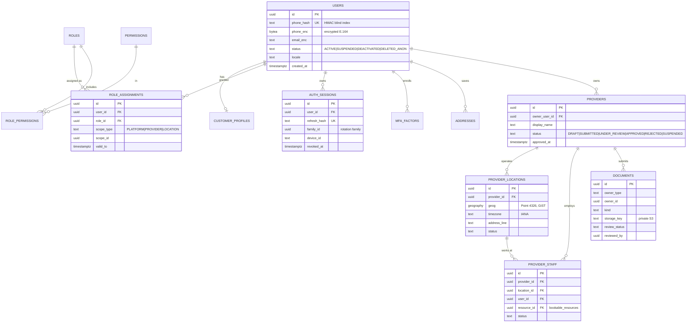

### G.3 ERD — Catalog & scheduling

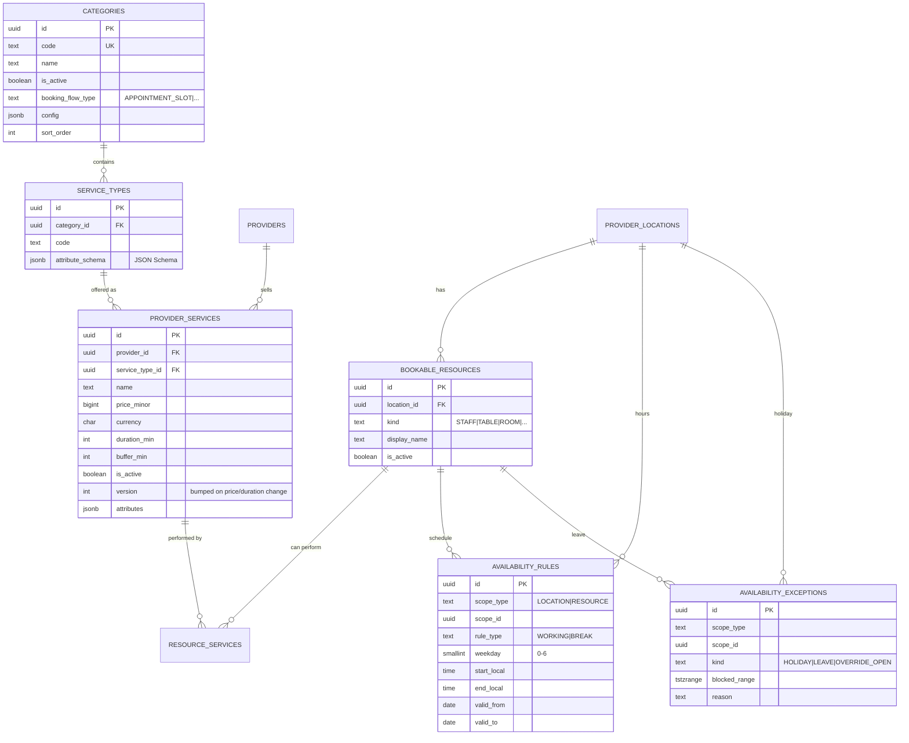

Also in this schema: `booking_policies` (lead time, max advance, slot granularity, response deadline, check-in window, stale-booking grace, dispute window), `cancellation_policies` + `cancellation_policy_tiers` (hours-before → refund %), `commission_rules` — each with `scope_type/scope_id`, `effective_from/to`, `version`.

### G.4 ERD — Booking

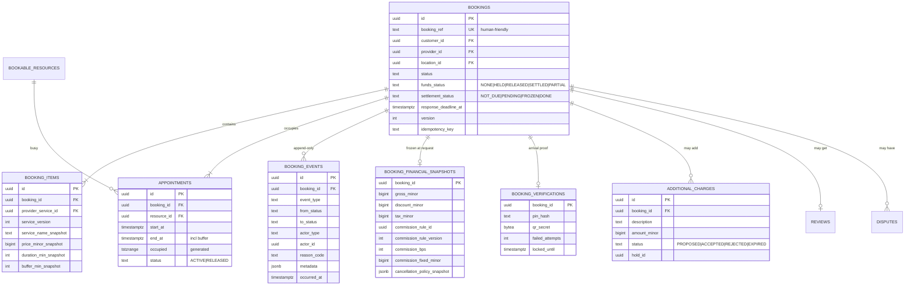

**Core scheduling constraint** (the main double-booking defence):

```sql
-- sketch only (final DDL arrives in Phase 3 migrations)
ALTER TABLE booking.appointments
  ADD CONSTRAINT appointments_no_overlap
  EXCLUDE USING gist (resource_id WITH =, occupied WITH &&)
  WHERE (status = 'ACTIVE');
```

`occupied` = `tstzrange(start_at, end_at)` where `end_at` already includes the service buffer. Terminal/cancelled bookings set `status='RELEASED'`, freeing the range.

### G.5 ERD — Financial

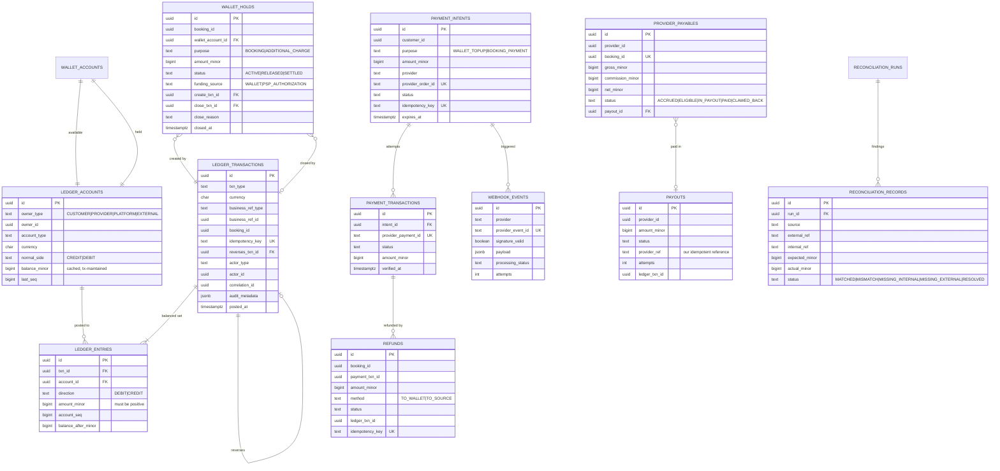

### G.6 Integrity rules and DB-level protections

| Rule | Mechanism |
|---|---|
| Ledger entries/transactions are **immutable** | `BEFORE UPDATE OR DELETE` triggers that `RAISE EXCEPTION`; the application DB role has **no** UPDATE/DELETE privilege on ledger/audit/booking_events tables. |
| Every ledger transaction **balances** | Deferred constraint trigger: `Σ debits = Σ credits` per `txn_id` at commit. Also `CHECK (amount_minor > 0)`. |
| Customer balances **never negative** | `CHECK (balance_minor >= 0)` on customer ledger accounts (the "available" and "held" accounts). Provider payable may only go negative via an approved clawback/adjustment type. |
| Cached balance ≡ entries | `balance_minor` updated in the same transaction by the ledger module only; nightly job recomputes from entries and alerts on drift (§29). |
| One active hold per (booking, purpose) | Partial unique index `WHERE status='ACTIVE'`. |
| Hold released/settled **once** | State change by conditional `UPDATE … WHERE status='ACTIVE' RETURNING`; zero rows ⇒ already closed ⇒ idempotent no-op returning the prior result. |
| One settlement per booking | Unique `(booking_id)` on `provider_payables` and unique `idempotency_key` on the ledger transaction (`settle:{booking_id}`). |
| Refund ≤ refundable amount | Check in the refund command **under lock** (sum of prior refunds + settled portions ≤ original captured/held), plus a DB constraint on cumulative refund via trigger. |
| Webhook dedupe | `UNIQUE (provider, provider_event_id)`. |
| Idempotent commands | `idempotency_records UNIQUE (principal_id, endpoint, key)` + request hash compare. |
| Module write ownership | Separate PG schemas; module DB roles/GRANTs per schema (app uses one login but separate SET ROLE per module in prod hardening — ADR; at minimum, CI-enforced). |
| Indexes | GiST on `provider_locations.geog` and `appointments.occupied`; btree on `(provider_id, status, start)`, `(customer_id, created_at desc)`, partial index on `bookings(response_deadline_at) WHERE status='REQUESTED'`, `outbox_events(status, available_at)`, etc. (finalized with `EXPLAIN` during phases). |

### G.7 Retention & soft delete (placeholders — final periods set by counsel/CA)

Financial and audit records retained for the legally required period; PII is *anonymized* on deletion (name/phone/email/addresses/photos removed or irreversibly replaced), leaving pseudonymous IDs on ledger/audit rows. Location search inputs are not stored. Raw webhook payloads retained for a limited period then redacted.

### G.8 Migration policy

Forward-only, reviewed SQL; **expand → migrate → contract**; destructive migrations (drop/rename) never run automatically against prod — they require a separate approved change (§32). Migrations run as a one-off ECS task before the new app version is rolled out.

---

## H. Provider search and availability design

### H.1 Search

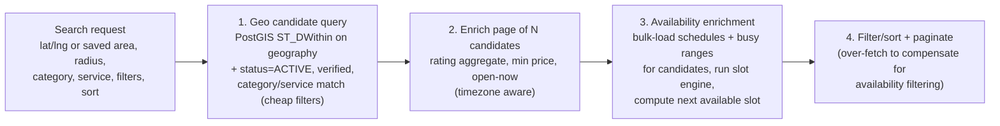

- **Geo:** `provider_locations.geog geography(Point,4326)` with a GiST index; radius via `ST_DWithin`; distance via `ST_Distance`; map view via **bounding-box** query (`ST_MakeEnvelope`) with server-side clustering when marker count is high.
- **Read model:** a `search.location_summary` view/table (denormalized: active flag, category, min price per service type, rating avg/count, hours summary) refreshed by events from catalog/review — avoids joining everything per request. Starts as a plain view; becomes a maintained table only if `EXPLAIN` demands.
- **Filters (§8):** radius, category, service, price range, min rating, open-now, "available today / at time", staff availability, sort by distance/price/rating/next-available.
- **Availability-aware filters:** applying availability to *filtering* is the expensive part. Strategy: filter with cheap predicates first, then run the slot engine only on the top-K candidates (K ≈ 3× page size), with bulk-loaded data (one query per data type for the candidate set, not per provider). Results show *next available slot* only for returned items. **Trade-off:** a "has availability tomorrow 10:00" filter may under-return in dense areas beyond K; documented, and `K` is configurable. No precomputed slot tables in v1 (they go stale and double-source truth).
- **Open/closed:** computed from `availability_rules` + exceptions in the **location's timezone**.
- **Directions:** deep link (Google/Apple Maps) built client-side from the location coordinates.
- **Location privacy (§8, §25):** coordinates arrive as request parameters, are **not** written to DB or logs (logs record a coarsened geohash/rounded value at most, and only if needed for debugging, short TTL); saved addresses are explicit user actions. No background tracking.

### H.2 Availability engine

A **pure, deterministic domain function** (no I/O), fed by a loader — so it is exhaustively unit/property-testable:

```
slots(locationTz, resource schedules, location hours, exceptions, existing ACTIVE appointments,
      service {duration, buffer}, policy {granularity, lead_time, max_advance}, now, dateRange)
```

Algorithm, per resource per local date:

1. Expand weekly `availability_rules` for the **local date** in the location timezone → working intervals (DST-safe because expansion happens on local wall-clock then converts to UTC).
2. Intersect with **location opening hours**.
3. Subtract `BREAK` rules, `availability_exceptions` (leave/holiday), and **busy intervals** (`ACTIVE` appointments — including `REQUESTED` ones per S6 — with buffers).
4. Slice into candidate starts on the policy **granularity** (e.g., 15 min) where `[start, start + duration + buffer)` fits entirely inside a free interval.
5. Apply `lead_time` (≥ now + L) and `max_advance` (≤ now + M).
6. Filter resources by **skill** (`resource_services`); for "any stylist", union across eligible resources and keep, per start, the candidate list for later assignment.

**Never a guarantee (§10):** `GET /availability` is advisory. The commit path does the authoritative check:

1. Re-run `assertSlotFree` for the chosen `(resource, start, duration+buffer)` inside the booking transaction against locked/current data.
2. The `INSERT INTO appointments` then hits the **exclusion constraint**. A violation (`23P01`) maps to `409 SLOT_UNAVAILABLE`; for "any stylist" the engine retries the next candidate resource, then fails cleanly.

This gives correctness without a global lock: two simultaneous requests for the same stylist+overlap cannot both commit (one gets `23P01`).

### H.3 Time handling [R]

UTC `timestamptz` everywhere; `provider_locations.timezone` (IANA) used to interpret recurring rules and render times. API returns ISO-8601 UTC plus `local_start`/`tz` for display convenience. DST transitions and half-hour offsets (IST) covered by property tests.

---

## I. Booking state machine

### I.1 Separate status dimensions (§15 requirement)

| Dimension | Values | Lives in |
|---|---|---|
| **Booking lifecycle** (`bookings.status`) | below | `bookings` |
| **Funds** (`funds_status`) | `NONE`, `HELD`, `RELEASED`, `SETTLED`, `PARTIAL` (split between refund and settlement) | derived from holds, cached on booking |
| **Settlement** (`settlement_status`) | `NOT_DUE`, `PENDING`, `FROZEN` (dispute/open extra charge), `DONE` | `bookings` |
| **Payout** | `ACCRUED`, `ELIGIBLE`, `IN_PAYOUT`, `PAID`, `FAILED` | `provider_payables` |
| **Refund** | `REQUESTED`…`SUCCEEDED/FAILED` | `refunds` |
| **Payment intent / transaction** | PSP-facing statuses | `payment_*` |

So "service completed, settlement pending, payout not yet eligible" is representable without overloading one field.

### I.2 Diagram [REC]

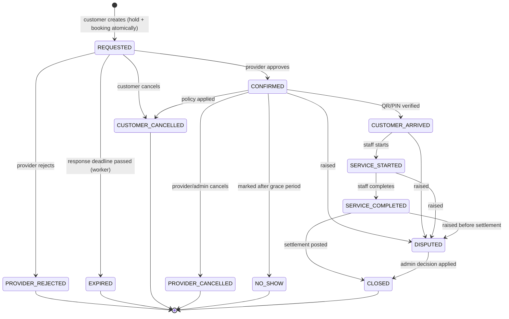

`DRAFT`, `PAYMENT_PENDING`, `PAYMENT_HELD` exist in the enum, used **only** for the per-booking-payment model (§13-B); in the wallet model they are transient inside the creating transaction (G3). `PROVIDER_APPROVED` collapses into `CONFIRMED` (G2). **[DEC]**

### I.3 Transition table (§15 requires all of these columns)

| # | From → To | Authorized actor | Preconditions | Financial side effect | Notifications | Audit / event | Failure handling |
|---|---|---|---|---|---|---|---|
| 1 | ∅ → `REQUESTED` | Customer (`booking:create`) | Valid idempotency key; service active & provider `APPROVED`; **server-priced**; slot valid; customer wallet `ACTIVE`; funds ≥ amount | **Create hold**: `DR CUST_AVAILABLE / CR CUST_HELD` | Provider: BookingRequested; Customer: HoldCreated | `BookingRequested`, `HoldCreated` events (+ outbox) | Single DB txn: any failure rolls back everything. `INSUFFICIENT_FUNDS` → 4xx with top-up hint; `SLOT_UNAVAILABLE` → 409; replay with same key returns the original result. |
| 2 | `REQUESTED` → `CONFIRMED` | Provider user with `appointment:respond` at that location | Before `response_deadline_at`; appointment still `ACTIVE` | None (hold persists) | Customer: BookingApproved | `BookingApproved` | Idempotent: re-approval returns current state. Late approval after expiry → 409. |
| 3 | `REQUESTED` → `PROVIDER_REJECTED` | Provider (same) | Reason code required | **Release hold**: `DR CUST_HELD / CR CUST_AVAILABLE`; appointment → `RELEASED` | Customer: rejected + HoldReleased | `BookingRejected`, `HoldReleased` | Release is conditional-update idempotent; same txn as state change. |
| 4 | `REQUESTED` → `EXPIRED` | System (worker) | `now > response_deadline_at`; re-checked **under row lock** | Release hold (as #3) | Customer: expired + released; Provider: missed request | `BookingExpired`, `HoldReleased` (reason `PROVIDER_TIMEOUT`) | `FOR UPDATE SKIP LOCKED` sweep + delayed job; if the provider approves concurrently, whoever takes the lock first wins, the other sees the new state. Job retries with backoff. |
| 5 | `REQUESTED` → `CUSTOMER_CANCELLED` | Customer | Own booking | Full release (no provider commitment yet) | Provider | `BookingCancelled` | Idempotent. |
| 6 | `CONFIRMED` → `CUSTOMER_CANCELLED` | Customer | Own booking; policy from **snapshot** evaluated at cancel time | **Split of hold per policy**: refund portion → `CUST_AVAILABLE`; fee portion → provider payable / commission (per snapshot); all in one balanced txn | Both | `BookingCancelled` w/ policy result | Refund amounts capped by hold amount; deterministic from snapshot. |
| 7 | `CONFIRMED` → `PROVIDER_CANCELLED` | Provider mgr/owner, support/admin | Reason code required | Full release (policy may add compensation — config) | Customer: priority notification | `BookingCancelled` (provider) | Idempotent; repeated cancellations no-op. |
| 8 | `CONFIRMED` → `CUSTOMER_ARRIVED` | Authorized provider staff at the location | Within configurable check-in window; valid **QR token or PIN**; attempts throttled | None | Customer (optional) | `CustomerArrived` | Wrong PIN increments counter; lockout after N attempts; QR token is short-lived, signed, opaque (no PII). |
| 9 | `CONFIRMED` → `NO_SHOW` | Provider staff/manager | After start time + grace; not already arrived | Per policy (e.g., fee retained / partial refund) | Customer | `NoShowMarked` | Customer may dispute (→ `DISPUTED`). |
| 10 | `CUSTOMER_ARRIVED` → `SERVICE_STARTED` | Assigned staff | — | None | Customer | `ServiceStarted` | Idempotent. |
| 11 | `SERVICE_STARTED` → `SERVICE_COMPLETED` | Assigned staff | Any additional charges either accepted or withdrawn; **never time-triggered** | None yet; `settlement_status = PENDING`; settlement job scheduled | Customer: completed + review requested | `ServiceCompleted` | **Duplicate completion** → no-op (unique transition + conditional update). |
| 12 | `SERVICE_COMPLETED` → `CLOSED` | System (settlement job) | Settlement conditions (G5) satisfied; no open dispute | **Settle hold**: `DR CUST_HELD / CR PROVIDER_PAYABLE + CR PLATFORM_COMMISSION`; payable row + commission row | Both: ProviderPayableRecorded | `ServiceSettled`, `ProviderPayableRecorded` | One settlement per booking by unique key; retry-safe. |
| 13 | any pre-`CLOSED` active state → `DISPUTED` | Customer or provider (or support) | Within dispute window | `settlement_status = FROZEN`; hold stays | Support queue; other party | `DisputeOpened` | Duplicate open dispute prevented by unique open-dispute-per-booking index. |
| 14 | `DISPUTED` → `CLOSED` | Authorized admin (maker-checker above threshold) | Decision recorded with evidence | Settle / release / split — **amounts ≤ hold** | Both | `DisputeResolved`, ledger txn refs | Compensating transactions only; amounts re-validated at execution time. |

**Rules:** no generic `PATCH /appointments/{id} {status}`; each transition is an explicit command endpoint (§O) executed by a state-machine function that validates the source state **under a row lock** and writes the transition + event + outbox rows in the same transaction.

### I.4 Arrival verification (§18)

- **QR:** encodes an opaque, HMAC-signed, short-lived token (booking id + nonce + expiry), **no PII**; rotating on each display; verified server-side by an authorized staff member of that location.
- **PIN:** 6-digit, stored as a salted hash, attempt-limited, lockout with audit.
- **Authorized confirmation:** a manager may mark arrival without QR/PIN (reason required, audited).

---

## J. Wallet ledger and hold/release design

### J.1 How the five distinctions in §38 are preserved

| Concept (§11) | Where it lives | Owed to | Moves when |
|---|---|---|---|
| Customer **available** balance | `CUST_AVAILABLE:{customer}` (liability) | Customer | Top-up success ↑; hold ↓; release/refund ↑ |
| Customer **held** funds | `CUST_HELD:{customer}` (liability) | Customer, *reserved* for a booking | Hold ↑; release ↓; settlement ↓ |
| **Provider payable** | `PROVIDER_PAYABLE:{provider}` (liability) | Provider (not yet paid) | Settlement ↑; payout ↓ |
| **Platform commission** | `PLATFORM_COMMISSION` (revenue) | Platform | Settlement ↑ (reversed on refund/adjustment) |
| **Completed payout** | `PAYOUT_CLEARING` (in-transit) then `GATEWAY_CLEARING` (cash/asset) | Provider (cash left platform) | Payout submit: payable ↓ clearing ↑; PSP confirmation: clearing ↓ gateway ↓ |

Because these are *different ledger accounts*, "money held for a booking" can never be confused with "money earned" or "money paid".

### J.2 Chart of accounts (v1)

| Account | Type | Owner |
|---|---|---|
| `GATEWAY_CLEARING` | Asset (funds at/through PSP, our claim) | Platform |
| `CUST_AVAILABLE`, `CUST_HELD` | Liability | per customer |
| `PROVIDER_PAYABLE` | Liability | per provider |
| `PLATFORM_COMMISSION` | Revenue | Platform |
| `PAYOUT_CLEARING` | Liability/in-transit | Platform |
| `REFUND_CLEARING` | Liability/in-transit | Platform |
| `ADJUSTMENT` | Equity/expense (admin corrections only) | Platform |

Sign convention is explicit and tested; a **trial-balance invariant** (Σ debits = Σ credits across the whole ledger) is checked nightly.

### J.3 Posting rules (worked example from §12/§19 — illustrative ₹)

| Event | Ledger transaction (DR / CR) | Result |
|---|---|---|
| Top-up ₹1,000 verified | `DR GATEWAY_CLEARING 1000 / CR CUST_AVAILABLE 1000` | Available 1000, held 0 |
| Hold for ₹200 haircut | `DR CUST_AVAILABLE 200 / CR CUST_HELD 200` | Available **800**, held **200** |
| Provider rejects / expires | `DR CUST_HELD 200 / CR CUST_AVAILABLE 200` | Available 1000, held 0 |
| Settle (10% commission) | `DR CUST_HELD 200 / CR PROVIDER_PAYABLE 180 / CR PLATFORM_COMMISSION 20` | Held 0; payable 180; commission 20 |
| Late cancellation, 50% fee (policy) | `DR CUST_HELD 200 / CR CUST_AVAILABLE 100 / CR PROVIDER_PAYABLE 90 / CR PLATFORM_COMMISSION 10` | One txn, balanced |
| Payout ₹180 submitted | `DR PROVIDER_PAYABLE 180 / CR PAYOUT_CLEARING 180` | Payable 0, in transit 180 |
| Payout confirmed by PSP | `DR PAYOUT_CLEARING 180 / CR GATEWAY_CLEARING 180` | In-transit cleared |
| Payout failed | reversing txn `DR PAYOUT_CLEARING 180 / CR PROVIDER_PAYABLE 180` (`reverses_txn_id` set) | Payable restored |
| Refund to source ₹X | `DR CUST_AVAILABLE X / CR REFUND_CLEARING X`; on PSP success `DR REFUND_CLEARING X / CR GATEWAY_CLEARING X` | — |
| Admin correction | compensating txn through `ADJUSTMENT`, maker-checker | No row is ever edited |

Corrections are always **new** transactions referencing the one they reverse (§11).

### J.4 Transaction record (§11 required fields → columns)

Unique id ✔ `ledger_transactions.id`; account refs ✔ entries; type ✔ `txn_type`; amount/currency ✔; status — ledger rows are **only ever posted** (pending states live in `payment_*`/`payouts`; unresolved external outcomes use the `*_CLEARING` accounts) ✔; business reference ✔; booking reference ✔; idempotency key ✔ unique; timestamp ✔ `posted_at`; actor ✔; related txn ✔ `reverses_txn_id`; audit metadata ✔ jsonb (no secrets/PII).

### J.5 Hold state machine

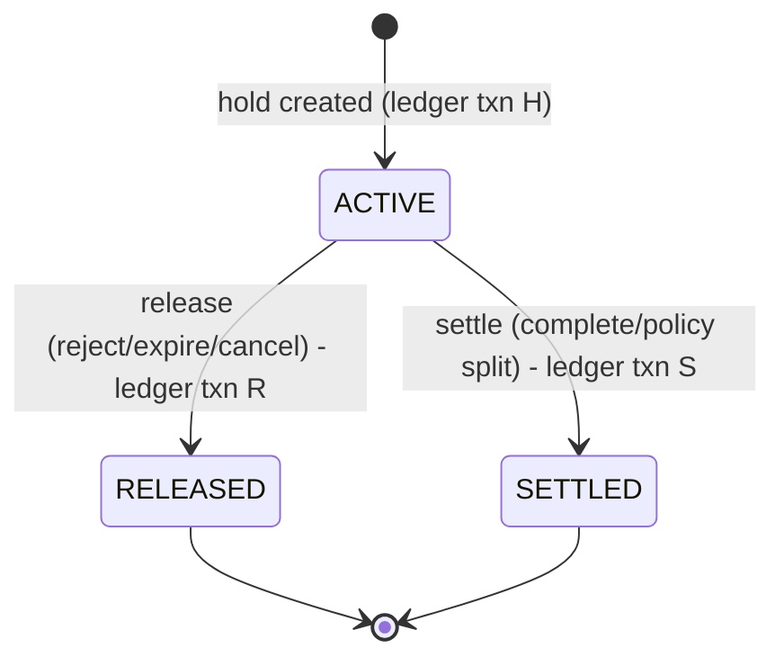

- Close operation: `UPDATE wallet_holds SET status=… WHERE id=:id AND status='ACTIVE' RETURNING …` **in the same transaction as the ledger posting**. Zero rows updated ⇒ already closed ⇒ return the recorded close result. This is how "the same hold is never released or settled twice" is *enforced*, not merely tested (§12).
- A hold has status, amount, booking ref, timestamps, create/close ledger refs ✔.
- Refund vs. settlement race (critical test #10): both operations first lock the hold row (`FOR UPDATE`); the second sees `status != ACTIVE` and cannot proceed.
- Prevent negative available: `CHECK (balance_minor >= 0)` + lock-then-check in the hold command (error `INSUFFICIENT_FUNDS`).

### J.6 Balance maintenance & reconciliation

- Hot read: `ledger_accounts.balance_minor` updated within the same txn (row-locked, `account_seq` monotonic per account).
- Verification (worker, nightly + on demand from admin): recompute from entries; compare; verify `Σ ACTIVE holds = CUST_HELD` per customer; every `CLOSED` booking has exactly one settlement txn and `payable + commission = gross`; global trial balance. Any violation → alert + `reconciliation_records` entry — **never an auto-fix**; fixes are compensating transactions with maker-checker.

### J.7 Commission policy [DEC]

- **Rule resolution:** most specific wins (service → provider → category → platform), effective-dated, versioned; the chosen rule id/version/rate is **frozen into `booking_financial_snapshots` at booking time** (§19).
- **Basis proposed:** commission = round-half-up(`basis_amount × bps / 10000`) on the **service amount actually settled** (after any refunds/fees decided pre-settlement and after provider-funded discounts; platform-funded discounts do not reduce the basis). Taxes excluded from the basis. The residual paise always goes to the provider side so amounts reconcile. **This is a business decision you must confirm (§19 asks it to be defined).**

---

## K. Payment, commission, payable, refund, and payout flows

### K.1 Payment models (§13) — evaluation

| | **A. Customer wallet + holds** | **B. Per-booking authorize/capture** | **C. Marketplace split-settlement (PSP-managed)** |
|---|---|---|---|
| How it works | Customer pre-loads funds; platform holds them in its ledger | Customer pays/authorizes per booking at request time; capture at completion | Customer pays per booking; PSP holds and splits settlement to provider/platform (subaccounts/"route"-style), with settlement-hold support |
| Fits §12 UX (available vs held) | ✔ native | Partially (no "balance"), but "held" ≈ authorization | Partially |
| Custody of funds | **Platform holds customer money** — most regulated | Card/bank network / PSP holds | PSP/escrow partner holds |
| Key regulatory concern (my understanding, *unverified*) | In India a multi-merchant stored-value wallet is generally a **prepaid payment instrument requiring RBI authorization**; closed-system exemptions are narrow. Refund/withdrawal rules are strict. | Authorization validity windows are **provider- and instrument-specific** (§13 warns); UPI/net-banking generally don't support long holds | Depends on PSP's marketplace product, nodal/escrow arrangement, KYC of providers (linked accounts) |
| Appointment-gap fit | Strong (funds held days) | Weak for long gaps; may need capture-then-refund | Medium–strong if settlement can be held until completion |
| Engineering risk | Highest (own ledger = own liability) | Medium (PSP state machine) | Medium |

### K.2 Recommendation [REC] **[DEC]**

1. **Build the ledger + hold model now** (Phase 4) because it is required by your design and is valuable under every model: a "hold" is simply *reserved value tied to a booking*.
2. Add `funding_source` to holds (`WALLET` | `PSP_AUTHORIZATION`) and make `payments` a port with adapters. If counsel/PSP say A is not permitted, the same booking/ledger flow can run with **B or C** by changing what *creates* the funds (a captured per-booking payment instead of a wallet top-up) — the booking, settlement, commission, payable and payout logic does not change.
3. **Sandbox/test-mode only** until the compliance gate (§K.4) is passed. Production keys are never provisioned in dev/QA, and a platform-level flag `REAL_MONEY_ENABLED=false` hard-blocks live-mode adapters. I will not describe the internal ledger as escrow anywhere in code, docs or UI (§13).

### K.3 Flows

**Add funds (top-up) — never trust the client:**

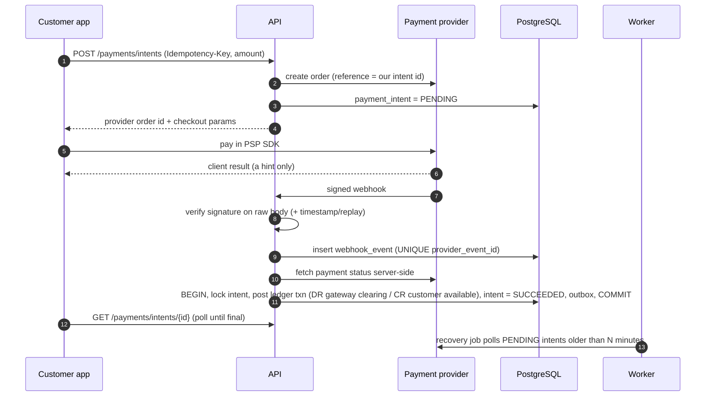

- **Duplicate webhook:** unique event id + ledger idempotency key `topup:{provider_payment_id}` ⇒ second delivery is a recorded no-op.
- **Delayed/missing webhook:** recovery job + reconciliation against PSP settlement reports (§14).
- **Failed/expired:** intent → `FAILED/EXPIRED`; no ledger entry is posted for money that never arrived.

**Booking → hold → settlement:**

```mermaid
sequenceDiagram
  autonumber
  participant C as Customer app
  participant API as API (booking + ledger in one DB txn)
  participant DB as PostgreSQL
  participant WK as Worker
  participant P as Provider app
  C->>API: POST /appointments (Idempotency-Key, service, slot, staff)
  API->>DB: BEGIN
  API->>DB: insert idempotency_record (unique) / replay stored result
  API->>DB: lock customer wallet row (FOR UPDATE)
  API->>DB: re-validate provider status, price, slot, lead time
  API->>DB: insert appointment (exclusion constraint)
  API->>DB: post hold ledger txn, hold ACTIVE, balances updated
  API->>DB: insert booking REQUESTED + snapshot + events + outbox
  API->>DB: COMMIT
  API-->>C: 201 booking REQUESTED
  WK->>P: push "new request" (from outbox)
  P->>API: POST /appointments/{id}/approve
  Note over P,API: ... arrival (QR/PIN) → start → complete ...
  WK->>DB: settlement job: re-check conditions under lock
  WK->>DB: ledger: DR held / CR payable + CR commission; hold SETTLED; booking CLOSED
```

**Payout (§19, §28 — payable is *not* money paid):**

```mermaid
sequenceDiagram
  autonumber
  participant WK as Payout worker
  participant DB as PostgreSQL
  participant PSP as Payout provider
  WK->>DB: select ELIGIBLE payables (verified provider, bank verified, dispute window passed, >= min threshold) SKIP LOCKED
  WK->>DB: create payout (idempotent reference = payout id), ledger: DR payable / CR payout clearing, payables IN_PAYOUT
  WK->>PSP: submit payout (reference = payout id)
  alt PSP confirms / webhook / poll
    PSP-->>DB: PAID: ledger DR payout clearing / CR gateway clearing
  else PSP rejects
    WK->>DB: FAILED: reversing ledger txn, payables back to ELIGIBLE, retry schedule
  else timeout / unknown
    WK->>PSP: query by our reference BEFORE any retry
    Note over WK,PSP: never blind re-send; unknown state is resolved by lookup
  end
```

**Refunds:** a refund is a command with its own idempotency key and state machine (`REQUESTED → APPROVED? → PROCESSING → SUCCEEDED | FAILED`). Method per approved model: `TO_WALLET` (ledger only, immediate) or `TO_SOURCE` (PSP refund, async, webhook-confirmed). Amount is validated **under lock** against what was actually captured/held/settled; refunding after settlement creates compensating entries and (if the payable is already paid out) a **clawback** recorded against future payables — requires maker-checker. Failures remain visible and retryable, never silently dropped.

### K.4 Payment-provider limitations and regulatory questions to resolve BEFORE production money [R §13]

*(My understanding, unverified; each needs confirmation by counsel/PSP in writing.)*

| # | Question / dependency |
|---|---|
| P1 | Does a customer-funded multi-provider wallet require **RBI PPI authorization** for us (or can we operate via a licensed PPI issuer/partner)? Refund and withdrawal restrictions on wallet balances? |
| P2 | If we use a **payment aggregator**: PA authorization status of the PSP; our obligations; whether the PSP's nodal/escrow arrangement lets us delay settlement to providers until completion. |
| P3 | PSP marketplace/split products (e.g., route/split-settlement style): provider (linked-account) KYC, settlement-hold support and duration, fees, and reversals/clawbacks after settlement. |
| P4 | **Authorization hold limits:** maximum authorization/capture window per instrument (card vs UPI vs net-banking) — appointments can be days ahead. |
| P5 | **Payout product** (bank transfers to providers): eligibility, KYC, per-payout fees, limits, status webhooks, and ability to **query by our reference** for timeout recovery. |
| P6 | **Tax:** GST on commission/services, TCS/TDS obligations for e-commerce operators, invoicing. Needs a CA. |
| P7 | **Data localization:** payment data storage in India; our use of `ap-south-1`. |
| P8 | **DPDP Act** (and its Rules, with phased commencement — confirm dates): notice/consent, children, retention, breach notification, grievance. |
| P9 | **Consumer-protection / e-commerce rules:** grievance officer, display requirements, refund timelines. |
| P10 | App-store policies for wallet/top-up and account deletion. |
| P11 | **TRAI DLT** for OTP SMS. |

**Gate:** Real-money flows stay disabled (hard flag + no live credentials in any environment) until P1–P7 are answered in writing and approved by you. (§13, §36 Phase 4 note.)

---

## L. Concurrency and idempotency strategy

### L.1 Layers (defense in depth)

1. **Idempotency key** on every sensitive command (`Idempotency-Key` header): `idempotency_records` keyed by `(principal, endpoint, key)`, stores request hash + final response. Same key + same payload ⇒ replay stored response; same key + different payload ⇒ `422`; in-flight ⇒ `409` (retry-after).
2. **Natural unique constraints** (second layer, independent of header discipline): one active hold per booking+purpose, one settlement per booking, unique webhook event id, unique ledger idempotency key, unique payout reference.
3. **Row locks** (`FOR UPDATE`) on the aggregate being changed, with a **fixed lock order** to avoid deadlocks: customer wallet account → booking → hold → provider payable. Deadlock/serialization failures are retried a bounded number of times by the transaction wrapper.
4. **Constraints as the final arbiter**: exclusion constraint for overlap; `CHECK` for non-negative balances.
5. **Isolation:** default `READ COMMITTED` with explicit locks and constraints (predictable, avoids widespread serialization retries); `SERIALIZABLE` is used only where analysis shows it is simpler/safer (to be recorded per use in ADR).
6. **Outbox** written in the same transaction as the state change; the dispatcher claims rows with `SKIP LOCKED` and is idempotent by `(event_id, consumer)`.
7. **Jobs** are idempotent and re-check state under lock before acting ("what the job saw when scheduled" is never trusted).

### L.2 Mapping of §28 failure cases and §29 critical tests

| # | Scenario (§29 critical tests) | Mechanism | Verified by |
|---|---|---|---|
| 1 | Two simultaneous requests book the **same slot** | Exclusion constraint on `(resource_id, occupied)`; loser gets 409 | Integration test with N parallel real DB connections: exactly 1 succeeds |
| 2 | Two requests **spend the same wallet funds** | Wallet row lock + `CHECK(balance >= 0)`; second sees insufficient balance | Parallel test: balance 200, two ₹200 bookings → exactly one succeeds, available = 0, held = 200 |
| 3 | Same booking request submitted twice | Idempotency record replay + unique constraints | Replay returns identical response; exactly one booking + one hold |
| 4 | Same payment webhook twice | `UNIQUE(provider_event_id)` + ledger idempotency key | One credit; second marked duplicate |
| 5 | Hold release executed twice | Conditional update `WHERE status='ACTIVE'` | One ledger txn; second returns prior result |
| 6 | Service completion executed twice | State machine from-state check under lock; unique transition | One completion event; one settlement job |
| 7 | Payout retried after timeout | Our reference is the PSP idempotency key; **query-before-retry** on unknown | Simulated timeout test: single PSP payout |
| 8 | Booking creation fails during financial reservation | Same DB txn ⇒ rollback; nothing persists | Fault-injection test after hold, before commit |
| 9 | Reservation succeeds but a later op fails | Later ops are either inside the txn (rollback) or after commit via outbox (retried, idempotent, with reconciliation) | Fault-injection at each step; invariants re-checked |
| 10 | Refund and settlement conflict | Both lock hold row; second sees non-ACTIVE | Parallel test: exactly one outcome, ledger balanced |

Also covered (§28): provider timeout (worker expiry), app closure mid-booking (client-persisted key + query outcome), notification failure (outbox retries; no effect on money), payment timeout/delay (recovery job), payout failure (reversal + retry), DB failure (rollback + retry).

---

## M. Security architecture

### M.1 Controls (§24)

| Area | Design |
|---|---|
| **Customer/Provider auth** | Mobile **OTP login** (SMS). OTP: random 6-digit, stored **hashed**, 5-min TTL, ≤5 attempts, resend cooldown, per-phone/per-device/per-IP throttles (Postgres counters + WAF), generic error messages (no user enumeration). |
| **Tokens** | Short-lived **access JWT** (≈10–15 min, asymmetric signing, key in KMS/Secrets Manager); **opaque refresh token** (stored hashed) with **rotation and reuse detection** (token family revoked on reuse); device-bound sessions listed and revocable; logout revokes the family. |
| **Privileged accounts** | Email+password (Argon2id) + **mandatory TOTP MFA**; step-up re-auth for sensitive actions; session timeouts; optional WebAuthn later. Password reset via emailed single-use expiring token (privileged users). |
| **Brute-force** | Progressive lockout/backoff, IP+account throttles, alerting on spikes. |
| **RBAC (§4)** | Permissions as `resource:action` (e.g., `appointment:respond`, `refund:approve`, `ledger:adjust`); roles bundle permissions; **role assignments are scoped** (`PLATFORM`/`PROVIDER`/`LOCATION`). A central guard checks permission **and** object ownership (`provider_id` / location membership) on every protected route; repositories take the actor scope so queries are scoped *by construction* (IDOR defense), not only by controller checks. |
| **Roles (§4)** | Customer, Provider Owner, Provider Manager, Provider Staff, Platform Admin, Support Operator, Finance/Reconciliation — each mapped to explicit permission sets; **separation of duties** (e.g., support cannot approve refunds above threshold; finance cannot edit catalog; maker ≠ checker). |
| **Input/output** | Schema validation on every endpoint (DTO + whitelist, reject unknown fields); parameterized SQL only; output encoding in admin; file names never trusted. |
| **Transport** | TLS 1.2+ end-to-end (CloudFront/ALB, in-VPC to RDS with TLS), HSTS. |
| **Headers/CORS/CSRF** | Helmet defaults, strict CSP on admin, locked CORS allow-list; CSRF protection on cookie-authenticated admin routes (mobile uses bearer tokens). |
| **Secrets** | AWS Secrets Manager; injected at runtime as env/secret refs; never in repo/images; rotation policy; gitleaks in CI. |
| **Encryption at rest** | RDS/S3/EBS with KMS. **Field-level (envelope) encryption** for high-sensitivity values (phone, email, provider bank/PAN details) with **HMAC blind indexes** for lookup. Card data **never** touches our systems (PSP-hosted checkout; no CVV storage). |
| **Webhooks** | Verify HMAC on the **raw body**, reject stale timestamps, constant-time compare, persist the event (accepted or rejected), idempotent processing. |
| **File uploads** | Presigned URLs to a **quarantine** bucket → content-type/size checks → malware scan → promoted to the private bucket; images re-encoded/EXIF-stripped; downloads via short-lived presigned URLs; documents never public. |
| **Rate limiting** | WAF rate-based rules + per-endpoint application limits (stricter on `/auth`, `/payments`, verification PIN). |
| **Audit (§30)** | Append-only `audit_logs`: actor, action, entity, before/after (sanitized), request id, IP/device (minimized). Includes "viewed unmasked PII". |
| **Logging** | Redaction layer: **never** log OTPs, passwords, tokens, payment secrets, full phone numbers, or coordinates. Correlation ID on every request/job/event. |
| **Supply chain** | Dependabot/Renovate, `npm audit`/OSV scan, container scan (Trivy), SAST (Semgrep/CodeQL), SBOM, pinned base images, signed images (optional). |
| **Mobile** | Secure storage; HTTPS only; certificate pinning considered (rotation complexity noted); no secrets/keys in app beyond restricted public map keys; release obfuscation. |
| **Threat modeling** | STRIDE workshop per major flow (auth, booking, wallet, webhook, payout) in Phase 0 follow-up and again in Phase 9. OWASP ASVS L2 as the checklist; OWASP Top 10 + API Top 10 review before production. |

### M.2 High-value abuse cases I will explicitly test

IDOR on bookings/wallets/documents · replayed webhook · forged webhook · client-supplied price/amount · double-spend via parallel requests · OTP brute-force and SMS-pumping · refresh-token theft/reuse · privilege escalation via role assignment · maker approving own request · race between refund and settlement · QR token replay/sharing · enumerating booking refs · mass assignment (setting status/commission via API).

---

## N. PII data-flow architecture (§25)

### N.1 Data classification

| Data | Class | Collected from | Stored where | Who can access | Shared with | Retention (placeholder) |
|---|---|---|---|---|---|---|
| Phone number | PII – high | Customer/Provider at signup | `identity.users` (encrypted + blind index) | Owner; support (masked; unmask audited) | SMS provider (for OTP), provider *only* on a confirmed booking if needed | Life of account → anonymize on deletion |
| Name | PII – medium | Profile | `customer_profiles` | Owner; provider (first name on bookings) | Provider (limited) | As above |
| Email | PII – medium | Profile/Admin | encrypted | Owner; admin | SES | As above |
| Address (saved) | PII – high | User action | `addresses` | Owner | — | Until deleted by user |
| **Live location** | **Sensitive – ephemeral** | Device (foreground, on demand) | **Not stored** (request-scope only) | — | Map provider only if client-side map SDK needs it | **None** |
| Provider docs (PAN, license, bank proof, ID photo) | **Sensitive** | Provider | S3 private (SSE-KMS) + metadata row | Verification staff (permissioned, audited) | Payout provider (bank details, as required) | Per legal retention |
| Profile / business photos | PII-low/public | Users | S3 (public-facing business photos via CDN signed URLs where appropriate) | — | — | Until removed |
| Booking history | PII-medium (behavioral) | System | `booking.*` | Owner; involved provider; support (scoped) | — | Retain for legal/financial period; anonymize identifiers on deletion |
| Payment references | Financial | PSP | `payments.*` | Finance/support (masked) | PSP | Financial retention period |
| Device tokens | PII-low | App | `notify.device_tokens` | System | FCM | Until logout/uninstall |
| Audit logs | Sensitive | System | `audit.*` | Admin (restricted) | — | Legal period; **no raw PII** in metadata |

### N.2 Flow

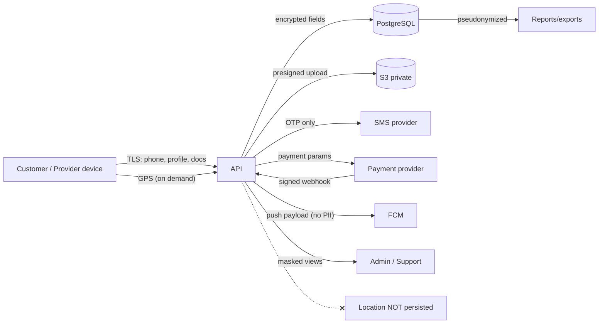

Plus the formal deliverable `PII-DATA-FLOW.md` (collection, storage, processing, sharing, access, retention, deletion) will be produced in Phase 1/9. Account deletion (G10): request → verification → cooling-off → **anonymization job** (PII removed/replaced; ledger/audit kept under pseudonymous id) → confirmation; data export supported (JSON) for the owner.

---

## O. API design and endpoint groups

### O.1 Conventions [R §23]

- Base `/api/v1`; **OpenAPI 3.1** generated from code and published in non-prod; typed clients generated for Dart and TS.
- **Envelope:** success `{ "data": …, "meta": { "request_id": … } }`; **errors** as RFC 7807 `application/problem+json` with stable machine codes (`INSUFFICIENT_FUNDS`, `SLOT_UNAVAILABLE`, `INVALID_STATE_TRANSITION`, `IDEMPOTENCY_CONFLICT`, `FORBIDDEN`, …).
- **Pagination:** cursor-based (`limit`, `cursor`); stable sort keys; filtering via explicit query params (no free-form SQL).
- **Correlation:** `X-Request-Id` accepted/generated and echoed; propagated into logs, jobs, outbox events.
- **Idempotency:** `Idempotency-Key` required on commands that create/mutate money, bookings, refunds, payouts.
- **Money:** `{ amount_minor, currency }`.
- **Commands vs. reads:** commands are explicit verbs (`POST /appointments/{id}/approve`); reads are side-effect-free. **No endpoint accepts a status, balance, commission, or payout outcome** (§23).
- Admin endpoints under `/api/v1/admin/*` with separate guards, stricter rate limits and mandatory MFA-authenticated sessions.

### O.2 Endpoint groups (illustrative, not final)

| Group | Examples |
|---|---|
| `/auth` | `POST /otp/request`, `/otp/verify`, `/token/refresh`, `/logout`, `/sessions` (list/revoke), admin: `/login`, `/mfa/verify` |
| `/users` | `GET/PATCH /me`, `/me/addresses`, `/me/consents`, `POST /me/export`, `POST /me/deactivate`, `POST /me/deletion-requests` |
| `/categories` | `GET /` (active only for clients), admin CRUD |
| `/services` | `GET /service-types?category=…`; provider-scoped services CRUD under `/providers/{id}/services` |
| `/providers` | `POST /` (register), `GET/PATCH /{id}`, `/{id}/locations`, `/{id}/documents`, `/{id}/submit-for-verification` |
| `/provider-staff` | invite, assign roles/skills, schedules, leave |
| `/availability` | `GET /slots?location=…&service=…&date=…&staff=…` |
| `/search` | `GET /providers?lat&lng&radius&category&service&…`, `GET /map?bbox=…` |
| `/appointments` | `POST /` (create), `GET /` (mine/provider), `GET /{id}`, `POST /{id}/approve|reject|cancel|verify-arrival|arrive|start|complete`, `POST /{id}/additional-charges`, `POST /{id}/additional-charges/{cid}/accept|reject` |
| `/wallet` | `GET /` (available/held), `GET /transactions` |
| `/payments` | `POST /intents`, `GET /intents/{id}`, `POST /webhooks/{provider}` (signature-verified, no auth cookie) |
| `/refunds` | `GET /`, admin: `POST /{id}/approve|retry` (maker-checker as configured) |
| `/payouts` | provider: `GET /payables`, `GET /payouts`; admin: monitoring, retry/hold with permission |
| `/reviews` | `POST /appointments/{id}/review`, `GET /providers/{id}/reviews`, admin moderation |
| `/notifications` | `GET /`, `POST /{id}/read`, `POST /devices` |
| `/disputes` | `POST /`, `GET /`, `POST /{id}/messages`, `POST /{id}/evidence`, admin decisions |
| `/admin` | users/roles, categories/service types, providers & verification, config (booking/cancellation/commission), approvals (maker-checker), reconciliation, reports, audit |

---

## P. AWS deployment architecture

### P.1 Topology [REC][ASM] (`ap-south-1`)

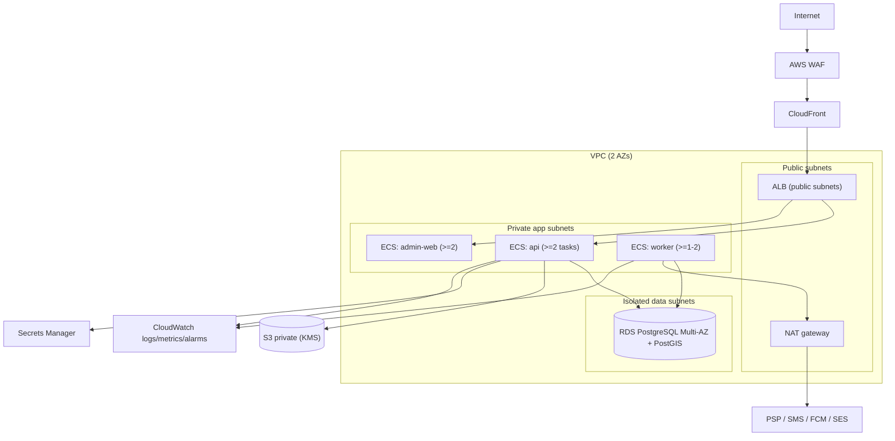

### P.2 Documented items (§31)

| Topic | Design |
|---|---|
| **Network boundaries** | Public: CloudFront/WAF/ALB only. App tasks in private subnets, no public IPs. RDS in isolated subnets reachable only from app security groups. Egress via NAT (or VPC endpoints for S3/Secrets/ECR/CloudWatch to cut NAT cost and exposure). |
| **IAM** | Separate task roles for `api` vs `worker` (least privilege: only the specific S3 prefixes/secrets each needs); CI deploy role via GitHub OIDC (no long-lived keys); no IAM users with console keys for humans (SSO); prod changes via pipeline only. |
| **Secrets** | Secrets Manager; rotation for DB creds; PSP/SMS keys injected at runtime; separate secrets per environment; **sandbox PSP keys only in dev/QA**. |
| **Encryption** | KMS CMKs for RDS, S3, Secrets, EBS/logs; TLS in transit everywhere; field-level encryption in app. |
| **Backups** | RDS automated backups with PITR (prod ≥ 14 days, consider 35); daily snapshots retained; **monthly restore drills**; S3 versioning on document buckets; cross-region snapshot copy for DR. |
| **Disaster recovery** | Targets (proposed, confirm): **RPO ≤ 15 min, RTO ≤ 4 h** in prod via Multi-AZ failover (AZ loss) and PITR/snapshot restore (data corruption); regional DR = copied snapshots + IaC rebuild (documented, drilled before launch); no active-active in v1. |
| **Scaling** | Stateless `api`/`admin-web`/`worker` scale on CPU/request count/queue depth; DB scales vertically first; read replica only when reporting/search load justifies; Redis only on evidence (§B.1). |
| **Deployment & rollback** | ECS rolling deployments with health checks + **deployment circuit breaker** (auto-rollback on failing health); migrations are backward-compatible (expand/contract) so rollback of app version is safe; DB rollback = restore/PITR for catastrophic cases (documented). |
| **WAF/DDoS** | Managed rule groups (OWASP, bot/IP reputation), rate rules, Shield Standard (included). |
| **Observability** | CloudWatch Logs (structured JSON), metrics + alarms → SNS → email/Slack/PagerDuty-style on-call; dashboards for booking funnel, outbox lag, ledger invariants, webhook failures. |
| **Environments** | `dev`, `qa/staging`, `prod` — **separate AWS accounts** (Organizations), same Terraform modules, different sizing/flags. Dev/QA single-AZ, small; prod Multi-AZ. Production data is **never** copied to lower environments without anonymization. |

---

## Q. CI/CD and environment strategy

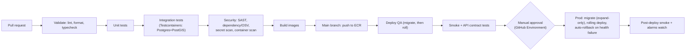

- **Mobile:** Fastlane (or Codemagic) builds → TestFlight / Play Internal Testing from `main`; production release via approval; flavors per environment.
- **Migrations:** automated in the pipeline as a one-off task *before* rollout; production runs only **backward-compatible** steps automatically; destructive changes need a separate approved procedure (§32).
- **Branching:** trunk-based with short-lived branches, required checks, protected `main`, CODEOWNERS on `ledger`, `booking`, `migrations`, `infra` (extra reviewers).
- **Feature flags:** simple DB/config-backed flags (`REAL_MONEY_ENABLED`, per-category enablement). Not a SaaS dependency in v1.
- **Docs-as-code:** ADRs and diagrams reviewed in PRs; CI fails if OpenAPI changes lack a regenerated client.

---

## R. Testing and observability strategy

### R.1 Testing (§29)

| Layer | Approach |
|---|---|
| Unit | Pure domain logic: availability engine (property-based with `fast-check`: no overlap, DST, boundaries), `Money`/commission math (round-trip invariants), state machine tables, policy resolution. |
| Integration | **Real PostgreSQL+PostGIS via Testcontainers** — no mocked DB for ledger/booking. Includes migrations applied from scratch and from previous version. |
| **Concurrency** | Parallel real connections for the 10 critical financial tests (§L.2); repeated runs (e.g., 100×) to flush flakiness; deadlock-retry tests. |
| **Ledger invariants** | After every financial test: balances = Σ entries, holds = held balance, trial balance, payable+commission=gross. Also a randomized "ledger fuzzer" executing random valid command sequences and asserting invariants. |
| API | Supertest/contract tests against OpenAPI; authorization matrix tests (every endpoint × every role × own/other tenant) to catch IDOR. |
| Payments | PSP adapter contract tests using the provider **sandbox** + recorded fixtures; forged/duplicate/out-of-order webhook tests. |
| Security | Automated authz/IDOR suite, ZAP baseline against QA, Semgrep rules, dependency scanning; manual OWASP review in Phase 9. |
| E2E | Flutter `integration_test` for core journeys on emulators; Playwright for admin; **full journey test** (discover → book → approve → arrive → complete → settle → payout(sandbox) → review) against QA. |
| Load | k6: search, slot generation, booking storms on a single popular slot, webhook bursts; targets set in Phase 9 (e.g., p95 search < 500 ms at S2 × 10 — proposed, to confirm). |
| Recovery | Restore-from-backup drill; kill-worker mid-job drill; PSP outage simulation. |
| Accessibility | Flutter semantics tests + manual screen-reader pass; axe on admin. |

**Rule (§29):** a phase is not "complete" while its critical tests fail. I will report actual test output, not summaries I haven't run.

### R.2 Observability

- **Logs:** pino JSON with `request_id`, `actor_id` (pseudonymous), `booking_id`; PII redaction middleware tested.
- **Traces:** OpenTelemetry across API → DB → worker jobs (via outbox/job metadata).
- **Metrics/alerts (examples):** outbox oldest-event age; job failure rate/DLQ depth; **ACTIVE holds past response deadline**; **ledger invariant violations (page immediately)**; webhook signature failures/duplicates; reconciliation mismatches; payout failures; 5xx rate/latency; DB connections, replication/CPU/storage; OTP send failure/abuse; login failures.
- **Business dashboards:** booking funnel, approval latency, expiry rate, top-up success rate, payout lag.
- **Crash/error:** Sentry (API/admin), Crashlytics (apps).

---

## S. Third-party dependencies and estimated costs

> Planning estimates only (±30–50%), **not quotes**; verify with current vendor pricing and your negotiated rates. USD unless stated.

### S.1 Dependencies

| Dependency | Purpose | Notes / risk |
|---|---|---|
| Payment provider (Razorpay/Cashfree/other — Q3) | Add funds, refunds, split settlement, payouts | Marketplace features and fees vary; sandbox first; **compliance gate §K.4** |
| SMS/OTP aggregator | OTP | DLT registration; SMS-pumping fraud controls |
| Firebase Cloud Messaging | Push | Free; Google dependency |
| Amazon SES | Email | Cheap; domain warm-up |
| Map provider (Google Maps / Mapbox) | Map rendering, geocoding/autocomplete | Pricing/terms differ; keep behind abstraction |
| AWS | Hosting | Below |
| Apple Developer Program / Google Play | Distribution | Annual/one-time fees; review lead times |
| Sentry (optional) / Crashlytics | Error monitoring | Free/cheap tiers at this scale |
| GitHub (Actions) | Source + CI | Per-seat/minutes |
| Legal/CA advisory | Regulatory/tax | **Likely the largest non-engineering cost and longest lead time** |

### S.2 Indicative AWS monthly run-rate (rough)

| Environment | Main components | Indicative monthly |
|---|---|---|
| **Prod** | RDS PostgreSQL (e.g., `db.t4g.medium`→`m6g.large` Multi-AZ + storage/backup), Fargate (api×2, admin×2, worker×1–2), ALB, NAT/VPC endpoints, WAF, CloudFront, S3, Secrets Manager, CloudWatch | **≈ $350–600** at launch scale |
| **QA** | Single-AZ small RDS, 1 task each, ALB | **≈ $120–200** |
| **Dev** | Smallest RDS, 1 task each; can stop off-hours | **≈ $80–150** |
| **Total** | | **≈ $550–950 / month** at launch; grows with traffic and DB size |

Variable costs: SMS per OTP (order of ₹0.15–0.35 — verify), PSP fees per transaction/top-up and per payout (verify, plus GST), map API calls beyond free tiers (Places/Geocoding), email (negligible), push (free).

### S.3 One-time/annual

Apple Developer (annual), Google Play (one-time), domains/TLS (ACM free), pen-test (recommended before production — external vendor quote), legal opinion, DLT registration fees.

---

## T. Delivery phases, dependencies, and effort estimates

### T.1 Approach

Phases follow §36, but each is delivered as **vertical slices** (backend + app/admin screens + tests + docs) so something demoable exists at the end of every phase. Acceptance criteria for each phase will be written and agreed **at the start of that phase** (§36); Phase 1's draft criteria are in §T.3 as an example.

### T.2 Estimates (team S3 ≈ 9 FTE; ±35%; re-estimated after Phase 0 decisions)

| Phase | Scope highlights | Effort (person-weeks) | Planned elapsed | Depends on |
|---|---|---|---|---|
| **0** Discovery & architecture | This document, ADRs, threat model, PSP/regulatory discovery, DLT start | 8 | 2 w | — |
| **1** Foundation | Monorepo, CI/CD base, IaC dev/QA, auth (OTP, tokens), RBAC, migrations, categories/services, provider registration, locations & staff | 30 | 6 w | P0 approval |
| **2** Customer discovery | Location handling, map, search, provider profile, catalog, slot engine, customer app shell | 24 | 5 w | P1 |
| **3** Booking engine | Booking creation, constraints, approval/reject, state machine, expiry, concurrency tests | 28 | 6 w (overlaps P2 by ~2 w) | P1, P2 (slots) |
| **4** Financial foundation | Ledger, wallets, holds, payment abstraction + sandbox, webhooks, refunds, commission/payables, reconciliation | 44 | 11 w (starts after P1; integrates with P3 in the last ~2–3 w) | P1, P3 integration |
| **5** Provider operations | Provider dashboard, schedules, arrival (QR/PIN), start/complete, walk-ins | 22 | 5 w | P3, P4 |
| **6** Notifications | Outbox dispatcher, push/email/SMS/in-app, templates, retries | 16 | 4 w | P3 (outbox) |
| **7** Reviews & disputes | Reviews, support/disputes, evidence, admin decisions | 18 | 4 w | P5 |
| **8** Admin portal & reporting | Config UI, verification queue, finance admin, reconciliation, reports, audit UI, maker-checker | 36 | ~14 w elapsed (incremental, starts ~P1+) | continuous |
| **9** Security & performance | OWASP/ASVS review, PII review, concurrency/load/recovery tests, accessibility | 20 | 4 w | feature freeze |
| **10** Production readiness | Prod infra, backups/DR drill, monitoring, runbooks, store prep, launch checklist | 18 | 4 w | P9 |
| **Total** | | **≈ 264 person-weeks (~61 person-months)** | **≈ 34 weeks planned critical path; ≈ 39–42 weeks (9–10 months) with 15–25% contingency** | |

**Parallel non-engineering track:** legal/PSP/tax/DLT/app-store accounts. These are *independent of engineering effort* and can delay **production money movement** beyond the dates below regardless of engineering progress.

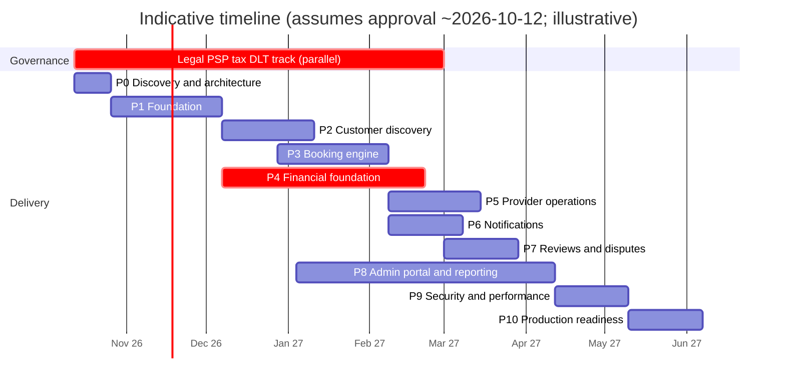

### T.3 Example acceptance criteria — Phase 1 (to be confirmed at phase start)

1. Monorepo builds from a clean checkout; CI runs lint, unit, integration, security scans on every PR and is green.
2. IaC provisions `dev` (and `qa`) from scratch; deploy pipeline deploys `api`/`worker` and runs migrations.
3. OTP login works (sandbox SMS), tokens rotate, reuse of a refresh token revokes its family, logout revokes session — all covered by tests.
4. RBAC: permission matrix tests prove every protected endpoint rejects unauthorized roles and cross-tenant access (no IDOR).
5. Admin can create an active/inactive category and service types via API (and basic UI); mobile fetches only active categories.
6. A provider can register, upload documents, define locations/staff, and be approved by an admin; an unapproved provider cannot be bookable.
7. Every sensitive change writes an audit log; logs contain no OTPs/tokens/PII (tested).
8. `ARCHITECTURE.md`, `DATABASE.md`, `SECURITY.md`, ADRs updated; no secrets in repo (scan passes).

---

## U. Key technical, operational, regulatory, and financial risks

| # | Risk | Likelihood / Impact | Mitigation |
|---|---|---|---|
| **R1** | **Wallet/escrow not legally permitted as designed** (RBI/PPI/PA, custody) — could invalidate the core UX | Med–High / **Critical** | Early legal opinion; funding-source-agnostic hold model; sandbox-only until approved; options B/C kept viable; no "escrow" claims |
| R2 | PSP lacks needed marketplace features (settlement hold, payout status lookup) | Medium / High | Capability checklist in Phase 0 (§K.4); adapter abstraction; shortlist ≥2 PSPs |
| R3 | Double-booking or double-spend under load | Low (by design) / Critical | Constraint-based design + parallel tests + load tests |
| R4 | Ledger drift/inconsistency | Low / Critical | Immutability enforcement, invariants, nightly reconciliation, alerts, no auto-fix |
| R5 | Hold stuck (booking never completed) | Medium / High | Stale-booking workflow (G4), alerts on aged holds, support queue |
| R6 | Provider rejection/timeout hurts conversion | Medium / Medium | Short configurable deadlines, reminders, auto-expiry, provider SLA metrics |
| R7 | Data breach / PII leak | Low–Med / High | Encryption, masking, least privilege, audit, pen-test, DPDP readiness |
| R8 | SMS OTP abuse (pumping) / DLT delays | Medium / Medium | Throttling, WAF, per-device limits, early DLT registration, fallback provider |
| R9 | Scope creep from "future verticals" | High / Medium | Extension points only; one flow strategy implemented; ADR on non-goals |
| R10 | Search/availability performance at scale | Medium / Medium | Top-K enrichment, bulk loading, indexes, load tests; read replica / Redis only on evidence |
| R11 | Third-party outages (PSP, SMS, FCM, maps) | Medium / Medium | Retries, circuit breakers, reconciliation, graceful degraded UI, provider failover for SMS |
| R12 | App-store rejection (wallet/top-up/deletion/privacy labels) | Medium / Medium | Policy review Phase 10; in-app deletion early; privacy manifests |
| R13 | Tax/GST/TDS-TCS misconfiguration | Medium / High | CA review, schema fields reserved, invoices/statements designed with finance |
| R14 | Team velocity vs. plan (S3) | Medium / High | Re-baseline after Phase 0; strict vertical slices; cut scope via flags not corners |
| R15 | Single region / single DB failure | Low / High | Multi-AZ, PITR, snapshot copy, drilled DR plan |
| R16 | Fraud (fake providers, review manipulation, refund abuse) | Medium / Medium | Provider verification, verified-completion reviews, velocity/refund limits, audit |

---

## V. Acceptance criteria for the first working release

**Definition:** a **pilot-ready** release in QA/staging using **sandbox payments only**, with Salon fully implemented end-to-end. *It does not include enabling real money (gated by §K.4).*

**Functional (the §39 journey)**
1. A customer registers/logs in by OTP, browses admin-configured categories (only Salon active), selects Haircut, uses current or manual location, and sees nearby salons on **map and list** with price, duration, rating, distance, open status, next available slot and cancellation policy.
2. Customer selects salon → service → stylist → slot; sees a **server-computed quote**; submits a booking with an idempotency key.
3. Insufficient funds → add-funds flow (sandbox PSP) → balance updates **only after verified webhook/server-side check**.
4. Sufficient funds → booking `REQUESTED` and hold `ACTIVE` created **atomically**; available/held balances displayed correctly.
5. Provider (approved) gets a notification, approves or rejects; rejection/expiry releases the hold exactly once; approval confirms.
6. At the salon: staff verifies **QR/PIN**, marks arrived, starts, completes (extra charges flow works with explicit customer acceptance).
7. Settlement posts balanced entries: provider payable + platform commission; hold `SETTLED`; booking `CLOSED`; both parties notified.
8. Payout (sandbox) runs for eligible payables with correct statuses, retries, and reversal on failure; payable ≠ paid is visible in the provider app.
9. Customer submits a rating/review (verified completed bookings only); cancellation/refund policy flows and refund status work; a basic dispute can be opened and resolved by an admin with an audited decision.
10. Admin portal: manage categories/service types, verify providers, view/configure policies & commission rules (maker-checker), monitor refunds/disputes/payouts/reconciliation, run key reports, view audit logs.

**Non-functional / quality gates**
11. All **10 critical financial tests (§29)** pass, repeatedly, including parallel-slot and parallel-spend tests; ledger invariants hold after the full test suite and the nightly reconciliation job reports clean.
12. Authorization matrix tests pass (no cross-tenant access); no endpoint can set status, balance, price, commission, or payout outcome from the client.
13. Webhook signature verification, duplicate and out-of-order handling tested; client-reported payment success is never trusted.
14. Security: OWASP-aligned review completed for in-scope flows; dependency/secret/container scans clean or risk-accepted in writing; logs verified free of OTP/token/PII.
15. PII: data-flow doc complete; account deactivation/deletion and data export work in QA; location never persisted.
16. Performance: agreed targets met in load tests (to be fixed in Phase 9).
17. Operability: structured logs/metrics/alerts live; backup restore drill done; runbooks written; rollback exercised in QA.
18. Docs listed in §35 exist and reflect what is actually built; every defect fixed during development has a root-cause note (§37).
19. Dev-only seed data (ABC Salon, XYZ Salon, Style Studio; Haircut ₹200, Shaving ₹100, Hair Coloring ₹500, Facial ₹300; stylists with varied schedules/breaks; demo customers/bookings; test wallet funds as clearly labeled test ledger transactions) loads in dev/QA and **cannot** run in production (guarded by environment check).

---

## W. Proposed repository structure (§1 rule 3: propose before creating)

```
TokenGo/
├─ README.md
├─ docs/
│  ├─ ARCHITECTURE-PROPOSAL.md        (this document; later split into ARCHITECTURE.md etc.)
│  ├─ ARCHITECTURE.md  DATABASE.md  API.md  SECURITY.md  PII-DATA-FLOW.md
│  ├─ DEPLOYMENT.md  BOOKING-STATE-MACHINE.md  WALLET-AND-LEDGER.md
│  ├─ PAYMENT-INTEGRATION.md  REFUNDS-AND-PAYOUTS.md  TESTING.md
│  ├─ ADMIN-GUIDE.md  CUSTOMER-GUIDE.md  PROVIDER-GUIDE.md
│  ├─ OPERATIONS-RUNBOOK.md  DISASTER-RECOVERY.md
│  └─ adr/  0001-modular-monolith.md  0002-nestjs.md  0003-postgres-postgis.md ...
├─ apps/
│  ├─ api/                            # NestJS: main.api.ts + main.worker.ts, one image
│  │  ├─ src/
│  │  │  ├─ shared-kernel/            # Money, Clock, UnitOfWork, errors, idempotency, outbox, authz guard
│  │  │  └─ modules/
│  │  │     ├─ identity-access/ customer/ provider-management/ catalog/
│  │  │     ├─ geo-search/ availability/ booking/ wallet-ledger/ payments/
│  │  │     ├─ settlement-payouts/ notifications/ reviews/ disputes/
│  │  │     ├─ administration/ reporting/ audit/
│  │  │     └─ (each: domain/ application/ infrastructure/ presentation/)
│  │  ├─ migrations/                  # SQL, forward-only
│  │  ├─ seeds/dev-only/
│  │  └─ test/ (integration, concurrency, contract, architecture)
│  └─ admin-web/                      # Next.js + TS (BFF)
├─ mobile/                            # Melos workspace
│  ├─ apps/customer_app  apps/provider_app
│  └─ packages/ core design_system api_client auth maps notifications booking_ui
├─ packages/
│  └─ api-contract/                   # OpenAPI artifacts + generated TS client
├─ infra/                             # Terraform: modules/ + envs/{dev,qa,prod}
├─ .github/workflows/                 # CI/CD
└─ docker/                            # Dockerfiles, docker-compose for local dev (Postgres+PostGIS)
```

I will not create any of this until you approve.

---

## X. Approval checklist

Please confirm, change, or reject each. "Approve all recommendations" is a valid answer.

| # | Decision | My recommendation |
|---|---|---|
| D1 | Backend = **NestJS/TypeScript**, SQL-first migrations + Kysely, `pg-boss` jobs | Approve |
| D2 | **No Redis** in v1; add on evidence | Approve |
| D3 | **Flutter** (Melos, Riverpod) with two apps + shared packages; **Next.js** admin with BFF | Approve |
| D4 | **AWS ap-south-1**, ECS Fargate, RDS Multi-AZ, Terraform, one account per environment | Approve |
| D5 | Ledger/hold design is **funding-source-agnostic**; real money disabled until §K.4 resolved | Approve (critical) |
| D6 | Booking state machine amendments: add `NO_SHOW`; collapse `PROVIDER_APPROVED` into `CONFIRMED`; `DRAFT/PAYMENT_PENDING/PAYMENT_HELD` transient in wallet model (G1–G3) | Approve |
| D7 | Settlement rule: customer-confirm **or** configurable dispute window (default 24 h); stale-booking workflow (G4/G5) | Approve |
| D8 | Additional charges create a second hold (G6) | Approve |
| D9 | Walk-in/blocked-time bookings in v1 (G12) | Approve |
| D10 | `bookable_resources` abstraction for future verticals; only slot strategy built | Approve |
| D11 | Commission basis & rounding policy (§J.7) | Approve / amend |
| D12 | Customers must be 18+ in v1 (G15) | Approve |
| D13 | `REQUESTED` bookings block the slot (S6); single service per booking in v1 UI (S5) | Approve |
| D14 | Terraform over CDK; GitHub + Actions | Approve / tell me your standard |
| D15 | Answers to **Q1–Q7** (country/entity, payment-model intent, PSP, team/budget, whiteboard, map provider, account ownership) | **Required** |

**On approval, the next step is Phase 1 (Foundation):** I will first write and agree the Phase 1 acceptance criteria with you, then create the repository structure above and start implementing in small, tested, reviewable increments.
